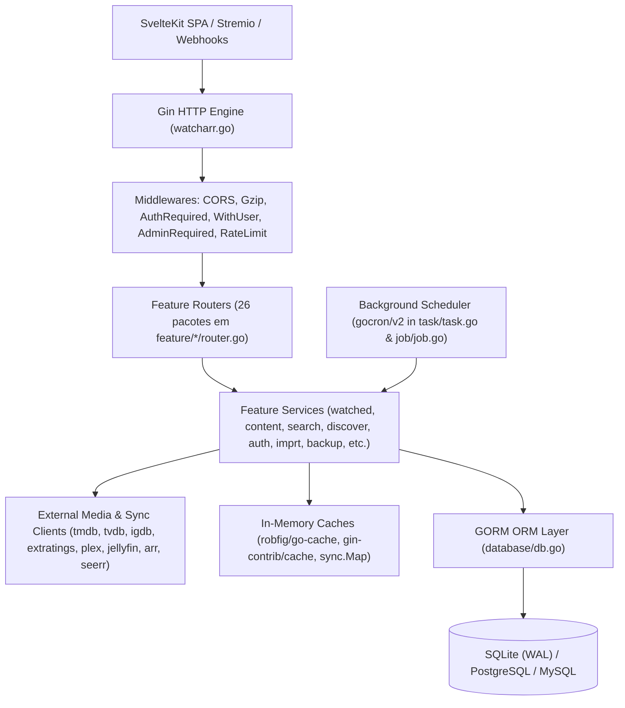

# BACKEND AUDIT REPORT — Watcharr (Go Backend)

> **Data da Auditoria:** 07 de Novembro de 2026  
> **Âmbito:** Auditoria profunda Multi-Agente (Read-Only) de 100% do backend Go (`server/`)  
> **Equipa de Auditoria:**
> - **Orchestrator:** Principal Software Engineer / Tech Lead
> - **AGENT 1 (`agent-1-bug-hunter`):** Senior Go Backend Bug Hunter (Lógica de Negócio, Handlers, Services, Concorrência, Media & Sync)
> - **AGENT 2 (`agent-2-db-perf-auditor`):** Database, Performance & Architecture Specialist (GORM, SQL Multi-Dialeto, Índices, Cache, Memória, Goroutines)
> - **AGENT 3 (`agent-3-security-auditor`):** Security, API & Reliability Auditor (Autenticação, JWT/OIDC/Proxy, RBAC, IDOR, SSRF, Backups, Rate Limiting, CORS)

---

## 1. Executive Summary (Resumo Executivo)

O backend do **Watcharr** (`server/`, Go 1.27, Gin, GORM) apresenta uma arquitetura modular orientada a funcionalidades (`feature/*`, `media/*`, `database/*`, `domain/*`), suportando filmes, séries (temporadas e episódios), jogos (IGDB/Steam), integrações externas (Plex, Jellyfin/Emby, Trakt, Sonarr, Radarr, Overseerr/Jellyseerr, Stremio/Nuvio, Simkl, OMDb, MDBList, Web Push) e três motores de base de dados (SQLite, PostgreSQL e MySQL/MariaDB).

Apesar de todos os pacotes compilarem sem erros e passarem nos testes unitários atuais em SQLite (`go vet ./...` e `go test ./...` com código de saída `0`), a auditoria linha-a-linha realizada pelos 3 agentes especializados identificou **56 problemas reais confirmados (`CONFIRMED`)** e **2 falsos positivos (`FALSE POSITIVE`)** descartados durante a fase de **Revisão Cruzada (*Cross-Agent Review*)**.

### Métricas Globais da Auditoria

| Métrica | Valor |
| :--- | :--- |
| **Total de Ficheiros Analisados no Backend (`server/`)** | **166 ficheiros** (162 ficheiros `.go` + `go.mod`, `go.sum`, `Makefile`, `VERSION`) + 4 ficheiros de infra (`Dockerfile`, `docker-compose*.yml`, `.github/workflows/test-pr-server.yml`) |
| **Total de Pacotes / Módulos Go Inspecionados** | **56 pacotes Go** (100% de cobertura do diretório `server/`) |
| **Total de Problemas Confirmados (`CONFIRMED`)** | **56** |
| **Prioridade P0 — CRITICAL (Crash / Perda de Dados / Segurança Crítica / Bloqueio de DB)** | **9** |
| **Prioridade P1 — HIGH (Bugs Graves / IDOR / Quebra de Funcionalidade / Inconsistência)** | **18** |
| **Prioridade P2 — MEDIUM (Bugs Funcionais / Performance / Concorrência / Segurança Média)** | **21** |
| **Prioridade P3 — LOW (Edge Cases / Higiene de Recursos / Formatação CI)** | **8** |
| **Falsos Positivos Descartados na Revisão Cruzada (`FALSE POSITIVE`)** | **2** |

### Destaques dos Problemas Críticos (P0)

1. **`[BUG-01]` Panic 100% Reprodutível no Web Push (`feature/push/router.go:58, 79, 98`):** Os endpoints `POST /api/push/subscribe`, `POST /api/push/unsubscribe` e `POST /api/push/test` fazem `c.MustGet("user").(entity.User)`, mas o middleware `usermiddleware.WithUser` guarda `*usermiddleware.UserForMiddleware` (que nem sequer possui campo `ID`), provocando *panic* em 100% das chamadas.
2. **`[BUG-02]` Nil Pointer Dereference Panic na Importação de Episódios por IMDb ID (`feature/imprt/importby.go:181`):** `importWithIMDBID` desreferencia `*ar.RatingCustomDate` sem verificar se é `nil`, causando *panic* imediato quando `ratingCustomDate` é omitido.
3. **`[SEC-01]` Path Traversal Não Autenticado em Windows via `path.Join` (`feature/img/router.go:40`):** A rota pública `GET /api/img/*filepath` utiliza `path.Join` (POSIX) em vez de `filepath.Join` sem validar `..` ou `\`. Em servidores Windows, pedidos como `/api/img/%5c..%5cwatcharr.json` permitem ler `watcharr.json` (incluindo `JWT_SECRET` e chaves de API) e `watcharr.db` sem autenticação.
4. **`[DB-01]` Perda Total de Passwords Locais e Violação de FKs no Backup/Restore JSON (`feature/backup/backup.go:258, 552`):** Como `entity.User.Password` tem a tag `gorm:"->:false;<-:create"`, o `s.db.Unscoped().Find(&dump.Users)` exporta `Password: ""` para todos os utilizadores. Ao restaurar o backup JSON (formato padrão para PostgreSQL/MySQL), todas as contas locais ficam com password vazia e inacessíveis, além de a ordem de eliminação/inserção violar chaves estrangeiras (`Games` inseridos após `Watched`, `Images` e `Follow` nunca restaurados, `watched_tags` perdido).
5. **`[DB-02]` Eliminação Diária de Todos os Posters de Jogos em `CleanupImages` (`image/image.go:69-75`):** A tarefa agendada `CleanupImages` verifica apenas `users.avatar_id = images.id` e ignora `games.poster_id = images.id`, apagando do disco e da BD todas as capas de jogos IGDB a cada 24 horas.
6. **`[DB-03]` Overflow Numérico ao Avaliar com Nota `10` em PostgreSQL e MySQL (`database/entity/watched.go:35`):** `Watched.Rating` está definido com `gorm:"type:numeric(2,1)"`, cujo valor máximo em SQL standard é `9.9`. Qualquer nota `10` falha com `numeric field overflow (SQLSTATE 22003)` em PostgreSQL e MySQL.
7. **`[DB-04]` Crash de Arranque em PostgreSQL na Migração `202603201715_0001` (`database/migrate/migrations.go:46, 63`):** Executa `.Update("count_as_play", 1)` numa coluna `boolean`, abortando o arranque em PostgreSQL com `SQLSTATE 42804`.
8. **`[DB-05]` Crash de Arranque em MySQL (`database/entity/*.go` & `migrations.go:335-467`):** Campos `string` indexados sem tamanho (`longtext` no MySQL) falham no `AutoMigrate` (`Error 1170`), e as migrações `0007`–`0012` usam `CREATE INDEX IF NOT EXISTS` (sintaxe inválida no MySQL 8.x, `Error 1064`).
9. **`[DB-06]` Falha Generalizada de Queries em PostgreSQL (`feature/watched/*`, `feature/user/*`, `feature/follow/*`, `feature/server/*`):** Uso de aliases de `JOIN` sem aspas (`Content.type`, `Game.name`) que o PostgreSQL converte para minúsculas (`SQLSTATE 42P01`), e comparações `boolean = integer` (`count_as_play = 1`, `private = 0`, `SQLSTATE 42883`).

---

## 2. Architecture Overview (Visão Geral da Arquitetura)



- **Ponto de Entrada (`server/watcharr.go`):** Configura limites de runtime (`debug.SetGCPercent(60)`, `debug.SetMemoryLimit`), logging (`slog` + `lumberjack`), configuração em ficheiro JSON (`data/watcharr.json`), ligação GORM + `AutoMigrate` + migrações manuais (`database/migrate`), motor HTTP Gin, injeção manual de dependências para 26 módulos em `feature/*`, e tarefas em background (`task.SetupTasks`, `contentService.BackfillMissingMetadata`).
- **Camada de Dados (`server/database/`):** Suporta SQLite (predefinido com WAL e `PRAGMA foreign_keys = ON`), PostgreSQL e MySQL. Contém 14 entidades GORM em `database/entity/` e 12 migrações manuais em `database/migrate/migrations.go`.
- **Gestão de Estado e Cache:** Utiliza 4 mecanismos distintos em memória:
  1. `persistence.InMemoryStore` (`gin-contrib/cache`) em `BaseRouter.MemStore`.
  2. `robfig/go-cache` em `tmdb.ContentStore`, `igdb.GameStore`, `tvdb.store`, `extratings.RatingsCache` e `watched.watchedPageCache`.
  3. `sync.Map` em `watched.seasonCache`.
  4. Mapas protegidos por mutex em `job/job.go` e `router/ratelimit.go`.

### Diagnósticos Executados (Secção 6)

| Comando / Verificação | Resultado | Observações |
| :--- | :--- | :--- |
| `go version` | `go1.27.2 windows/amd64` | Compilador atualizado. |
| `go vet ./...` | **PASS (`exit 0`)** | Nenhum erro estático reportado pelo `go vet`. |
| `go test ./... -cover` | **PASS (`exit 0`)** | 16 pacotes com testes passam; **40 pacotes têm 0.0% de cobertura** (sem ficheiros de teste). |
| `gofmt -l .` | **FAIL (39 ficheiros)** | 39 ficheiros `.go` falham a verificação de formatação exigida pelo workflow `.github/workflows/test-pr-server.yml`. |
| `go test -race ./...` | **Limitação de Ambiente** | Requer `CGO_ENABLED=1` e `gcc` no `PATH`; o ambiente Windows local não possui `gcc` instalado (`cgo: C compiler "gcc" not found`). Todas as condições de corrida foram auditadas estaticamente em detalhe. |

---

## 3. Audit Coverage (Inventário Completo de Módulos Analisados)

Todos os **56 pacotes / módulos** e **166 ficheiros** do backend (`server/`) foram inspecionados sem exceção:

| # | Módulo / Pacote | Ficheiros Inspecionados | Agente Responsável | Estado | Problemas Encontrados |
| :--- | :--- | :--- | :--- | :--- | :--- |
| 1 | `main` (`server/`) | `watcharr.go`, `go.mod`, `go.sum`, `Makefile`, `VERSION` | Agent 2 & Agent 3 | **CONCLUÍDO** | `SEC-02`, `REL-03`, `ARCH-02`, `SEC-15` |
| 2 | `config` & `config/cfgmodel` | `config.go`, `arr_settings.go` | Agent 2 & Agent 3 | **CONCLUÍDO** | `SEC-06`, `REL-02` |
| 3 | `database`, `dbmodel`, `entity`, `migrate` | `db.go`, `db_test.go`, `gorm_model.go`, `entity/*.go` (14 ficheiros), `migrate/*.go` (3 ficheiros) | Agent 2 (+ Cross-Review Agent 3) | **CONCLUÍDO** | `DB-03`, `DB-04`, `DB-05`, `DB-07`, `DB-08`, `DB-09` |
| 4 | `domain` | `activity.go`, `calendar.go`, `content.go`, `discover.go`, `import.go`, `media*.go`, `search.go`, `tag.go`, `user.go`, `watched*.go` (14 ficheiros) | Agent 1 & Agent 2 | **CONCLUÍDO** | `BUG-07`, `PERF-01` |
| 5 | `router` | `router.go`, `middleware.go`, `ratelimit.go` | Agent 2 & Agent 3 | **CONCLUÍDO** | `SEC-03`, `BUG-21` |
| 6 | `cache` | `cache.go` | Agent 1 & Agent 2 | **CONCLUÍDO** | `PERF-03`, `ARCH-03` |
| 7 | `job` & `feature/job` | `job/job.go`, `feature/job/router.go` | Agent 2 & Agent 3 | **CONCLUÍDO** | `REL-05` |
| 8 | `task` & `feature/task` | `task/task.go`, `feature/task/router.go` | Agent 2 & Agent 3 | **CONCLUÍDO** | `REL-04` |
| 9 | `logging` | `logging/logging.go` | Agent 2 | **CONCLUÍDO** | `REL-03` |
| 10 | `token` | `token/token.go` | Agent 3 (+ Cross-Review Agent 2) | **CONCLUÍDO** | `SEC-04` |
| 11 | `activity` & `feature/activity` | `activity/activity.go`, `creator.go`, `creator_multi.go`, `feature/activity/router.go` | Agent 1, 2 & 3 | **CONCLUÍDO** | Sem bugs isolados (validado IDOR). |
| 12 | `feature/auth`, `authmiddleware`, `permission` | `auth.go`, `auth_oidc.go`, `auth_proxy.go`, `router.go`, `auth_middleware.go`, `jellyfin_middleware.go`, `permission.go` | Agent 2 & Agent 3 | **CONCLUÍDO** | `SEC-04`, `SEC-05`, `SEC-07`, `SEC-08`, `SEC-09`, `DB-10` |
| 13 | `feature/setup` & `setupglob` | `router.go`, `setupglob.go` | Agent 3 | **CONCLUÍDO** | `SEC-08` |
| 14 | `feature/user` & `usermiddleware` | `router.go`, `user.go`, `user_get.go`, `user_manage.go`, `user_middleware.go` | Agent 2 & Agent 3 | **CONCLUÍDO** | `DB-06`, `DB-14`, `BUG-01` |
| 15 | `feature/server` | `router.go`, `server.go` | Agent 2 & Agent 3 | **CONCLUÍDO** | `REL-06`, `DB-06`, `PERF-06` |
| 16 | `feature/backup` | `backup.go`, `backup_test.go`, `router.go`, `structs.go` | Agent 2 & Agent 3 | **CONCLUÍDO** | `DB-01`, `DB-11`, `SEC-10`, `REL-04` |
| 17 | `image` & `feature/img` | `image/image.go`, `image_test.go`, `saver.go`, `feature/img/router.go` | Agent 1, 2 & 3 | **CONCLUÍDO** | `SEC-01`, `DB-02`, `SEC-15` |
| 18 | `feature/watched`, `episode`, `season`, `addedtocontent`, `watchedutil` | `watched.go`, `watched_refine.go`, `watched_tag.go`, `watched_together.go`, `autofinish.go`, `export.go`, `router.go`, `episode/*.go`, `season/*.go`, `addedtocontent.go`, `watched_util.go` + 7 ficheiros `*_test.go` | Agent 1, 2 & 3 | **CONCLUÍDO** | `BUG-03`, `BUG-04`, `BUG-05`, `BUG-06`, `BUG-07`, `BUG-08`, `BUG-09`, `DB-06`, `DB-12`, `DB-13`, `PERF-01`, `PERF-05`, `PERF-07` |
| 19 | `feature/content` | `content.go`, `cancellation_guard.go`, `router.go` | Agent 1, 2 & 3 | **CONCLUÍDO** | `BUG-10`, `BUG-11`, `SEC-14`, `PERF-04` |
| 20 | `feature/search` | `engine.go`, `engine_test.go`, `parse_query_filters.go`, `parse_query_filters_test.go`, `router.go`, `search.go`, `search_extid.go` | Agent 1 & Agent 2 | **CONCLUÍDO** | `BUG-12`, `BUG-13`, `BUG-14` |
| 21 | `feature/discover` | `discover.go`, `router.go` | Agent 1 | **CONCLUÍDO** | `BUG-15` |
| 22 | `feature/franchise` | `curated.go`, `model.go`, `router.go`, `service.go` | Agent 1 | **CONCLUÍDO** | `BUG-16`, `BUG-17` |
| 23 | `feature/calendar` | `calendar.go`, `calendar_test.go`, `router.go`, `webhook.go` | Agent 1 & Agent 2 | **CONCLUÍDO** | `BUG-18`, `BUG-19` |
| 24 | `feature/imprt` | `import.go`, `import_trakt.go`, `importby.go`, `router.go` | Agent 1 (+ Cross-Review Agent 3) | **CONCLUÍDO** | `BUG-02`, `BUG-22`, `BUG-23`, `BUG-24` |
| 25 | `feature/jellyfin` | `jellyfin.go`, `jellyfin_sync.go`, `router.go`, `webhook.go`, `webhook_data.go`, `webhook_test.go` | Agent 1, 2 & 3 | **CONCLUÍDO** | `BUG-25`, `BUG-26`, `REL-07` |
| 26 | `feature/plex` & `plexmiddleware` | `plex.go`, `plex_redirect_test.go`, `plex_sync.go`, `plex_sync_test.go`, `router.go`, `plexmiddleware.go` | Agent 1, 2 & 3 | **CONCLUÍDO** | `REL-07` |
| 27 | `feature/game` | `games.go`, `router.go`, `steam.go`, `steam_test.go` | Agent 1 | **CONCLUÍDO** | `BUG-27` |
| 28 | `feature/tag` | `router.go`, `tag.go`, `tag_test.go` | Agent 1, 2 & 3 | **CONCLUÍDO** | `SEC-11`, `BUG-28`, `PERF-02`, `SEC-17` |
| 29 | `feature/follow` | `follow.go`, `router.go` | Agent 1, 2 & 3 | **CONCLUÍDO** | `SEC-12`, `DB-06` |
| 30 | `feature/profile` | `profile.go`, `profile_test.go`, `router.go` | Agent 1 | **CONCLUÍDO** | `BUG-29` |
| 31 | `feature/push` | `push.go`, `push_test.go`, `router.go` | Agent 2 & Agent 3 (+ Cross-Review Agent 1) | **CONCLUÍDO** | `BUG-01`, `SEC-13`, `DB-15` |
| 32 | `feature/integration` | `activity_webhook.go`, `activity_webhook_test.go`, `integration.go`, `integration_test.go`, `router.go` | Agent 3 | **CONCLUÍDO** | `SEC-16`, `BUG-30` |
| 33 | `feature/addon` | `addon.go`, `addon_test.go`, `router.go`, `types.go` | Agent 1, 2 & 3 | **CONCLUÍDO** | `BUG-31`, `BUG-32`, `PERF-08` |
| 34 | `arr` & `feature/arr` | `arr/arr.go`, `arr/structs.go`, `feature/arr/arr.go`, `arr_queue.go`, `arr_requests.go`, `arr_requests_manage.go`, `router.go` | Agent 2 & Agent 3 | **CONCLUÍDO** | `BUG-33`, `REL-02` |
| 35 | `seerr` & `feature/seerr` | `seerr/seerr.go`, `seerr_test.go`, `structs.go`, `feature/seerr/router.go`, `router_test.go` | Agent 3 | **CONCLUÍDO** | `SEC-18` |
| 36 | `feature/feature` | `feature.go`, `router.go` | Agent 3 | **CONCLUÍDO** | Sem vulnerabilidades ou bugs. |
| 37 | `media/tmdb`, `tvdb`, `igdb`, `extratings` | `tmdb/*.go` (11 ficheiros), `tvdb/*.go` (2 ficheiros), `igdb/*.go` (2 ficheiros), `extratings/extratings.go` | Agent 1 & Agent 2 | **CONCLUÍDO** | `REL-01`, `PERF-03`, `PERF-04`, `BUG-34` |
| 38 | `tri`, `util`, `internal/testutil` | `tri/tri.go`, `util/*.go` (8 ficheiros), `internal/testutil/testutil.go` | Agent 1 | **CONCLUÍDO** | `BUG-20`, `ARCH-01` |

---

## 4. Confirmed Bugs (Bugs Funcionais Confirmados)

### `[BUG-01]` Panic de Type Assertion Garantido em Todos os Endpoints Autenticados de Web Push (`Subscribe`, `Unsubscribe`, `SendTest`)
- **ID:** `BUG-01`
- **Prioridade:** **P0 — CRITICAL**
- **Estado de Validação:** **CONFIRMED** (Validado pelos Agentes 1, 2 e 3)
- **Agente Responsável:** Agent 3 (Cross-Reviewed por Agent 1 & Agent 2)
- **Ficheiro e Linhas:** [router.go](file:///d:/Transferencias/projetosgithub/Watcharr/server/feature/push/router.go#L58), [L79](file:///d:/Transferencias/projetosgithub/Watcharr/server/feature/push/router.go#L79), [L98](file:///d:/Transferencias/projetosgithub/Watcharr/server/feature/push/router.go#L98) vs. [user_middleware.go](file:///d:/Transferencias/projetosgithub/Watcharr/server/feature/user/usermiddleware/user_middleware.go#L34-L45)
- **Função Afetada:** `(*Router).Subscribe`, `(*Router).Unsubscribe`, `(*Router).SendTest`
- **Descrição Técnica:** O grupo `/push` regista o middleware `usermiddleware.WithUser(r.br.DB)`, que armazena no contexto Gin a chave `"user"` com o tipo `*usermiddleware.UserForMiddleware` (struct que contém apenas `Username`, `Type`, `Permissions` e `UserSettings`, **sem campo `ID`**). No entanto, os três handlers de `push/router.go` executam `user := c.MustGet("user").(entity.User)`. Como o tipo dinâmico é `*usermiddleware.UserForMiddleware` e não `entity.User`, o runtime Go dispara um *panic* em 100% das chamadas.
- **Evidência:**
  ```go
  // server/feature/user/usermiddleware/user_middleware.go:34, 45
  user := new(UserForMiddleware)
  c.Set(reqContextKeyUser, user)

  // server/feature/push/router.go:58, 79, 98
  user := c.MustGet("user").(entity.User) // PANIC: interface {} is *usermiddleware.UserForMiddleware, not entity.User
  ```
- **Passos para Reproduzir:** Enviar qualquer pedido autenticado para `POST /api/push/subscribe`, `POST /api/push/unsubscribe` ou `POST /api/push/test`.
- **Impacto:** Indisponibilidade total (100% crash/HTTP 500) da funcionalidade de notificações Web Push.
- **Solução Recomendada:** Substituir `user := c.MustGet("user").(entity.User)` e `user.ID` por `userId := c.MustGet("userId").(uint)` nos três handlers e remover `usermiddleware.WithUser(r.br.DB)` do grupo `/push` em `AddRoutes()`.
- **Teste de Regressão:** Teste de integração HTTP invocando `POST /api/push/subscribe`, `POST /api/push/test` e `POST /api/push/unsubscribe` através do router Gin com `AuthRequired`.

---

### `[BUG-02]` Nil Pointer Dereference Panic em `importWithIMDBID` ao Importar Episódio sem `RatingCustomDate`
- **ID:** `BUG-02`
- **Prioridade:** **P0 — CRITICAL**
- **Estado de Validação:** **CONFIRMED** (Validado por Agent 1 & Agent 3)
- **Agente Responsável:** Agent 1
- **Ficheiro e Linhas:** [importby.go](file:///d:/Transferencias/projetosgithub/Watcharr/server/feature/imprt/importby.go#L165-L183)
- **Função Afetada:** `(*Service).importWithIMDBID`
- **Descrição Técnica:** Quando a pesquisa externa por IMDb ID retorna um único episódio (`SHOW_EPISODE`), `importWithIMDBID` chama `s.wep.SetWatchedEpisode` passando `AddActivityDate: *ar.RatingCustomDate`. O campo `ar.RatingCustomDate` é um ponteiro opcional `*time.Time` (`nil` sempre que o cliente não envia `"ratingCustomDate"`). Desreferenciar `*ar.RatingCustomDate` sem verificação de `nil` provoca um *panic* imediato (`invalid memory address or nil pointer dereference`). Adicionalmente, na linha 172, o log regista `"error", err` (que é `nil`) em vez de `"error", e`.
- **Evidência:**
  ```go
  // server/feature/imprt/importby.go:175-182
  _, err := s.wep.SetWatchedEpisode(userId, domain.WatchedEpisodeSetRequest{
      WatchedID:       w.ID,
      SeasonNumber:    onlyResult.SeasonNumber,
      EpisodeNumber:   onlyResult.EpisodeNumber,
      Status:          ar.Status,
      Rating:          int8(ar.Rating),
      AddActivityDate: *ar.RatingCustomDate, // PANIC se ar.RatingCustomDate == nil
  })
  ```
- **Passos para Reproduzir:** Adicionar uma série à lista e enviar `POST /api/import` com `{"imdbId": "tt0959621", "status": "FINISHED"}` sem o campo `ratingCustomDate`.
- **Impacto:** Crash do handler (HTTP 500) na importação de episódios por IMDb ID.
- **Solução Recomendada:** Usar `util.Deref(ar.RatingCustomDate, time.Time{})` na linha 181 e corrigir `"error", e` na linha 172.
- **Teste de Regressão:** Teste unitário `TestImportWithIMDBID_EpisodeNilRatingCustomDate`.

---

### `[BUG-03]` Geração Infinita de Episódios Fantasma em `AutoFinishWatcharrMedia`
- **ID:** `BUG-03`
- **Prioridade:** **P1 — HIGH**
- **Estado de Validação:** **CONFIRMED** (Detectado independentemente por Agent 1 & Agent 2)
- **Agente Responsável:** Agent 1 & Agent 2
- **Ficheiro e Linhas:** [autofinish.go](file:///d:/Transferencias/projetosgithub/Watcharr/server/feature/watched/autofinish.go#L105-L204)
- **Função Afetada:** `(*Service).AutoFinishWatcharrMedia`
- **Descrição Técnica:** A tarefa `AutoFinishWatcharrMedia` (executada a cada 2 minutos) procura episódios com `Status == entity.WATCHING` cujo tempo decorrido desde `UpdatedAt` exceda `epRuntime + 10m` (tipicamente 55 minutos). Quando marca o episódio `E` como `FINISHED`, o código incrementa incondicionalmente `nextEpNum := ep.EpisodeNumber + 1` (linha 163) e cria um novo registo `WatchedEpisode` para `nextEpNum` na mesma temporada com `Status: entity.WATCHING` (linhas 173–180), **sem verificar se o utilizador iniciou esse episódio e sem verificar no TMDB se o episódio `E+1` existe na temporada**. Passados mais 55 minutos, esse episódio `E+1` também expira, é marcado como `FINISHED` (gerando atividade `FINISHED_EPISODE`) e cria o episódio inexistente `E+2` como `WATCHING`, repetindo-se infinitamente (~26 episódios fantasma criados por dia para sempre).
- **Evidência:**
  ```go
  // server/feature/watched/autofinish.go:163-180
  nextEpNum := ep.EpisodeNumber + 1
  var nextEp entity.WatchedEpisode
  err := s.db.Where("watched_id = ? AND season_number = ? AND episode_number = ?", w.ID, ep.SeasonNumber, nextEpNum).First(&nextEp).Error
  if err != nil && errors.Is(err, gorm.ErrRecordNotFound) {
      newNextEp := entity.WatchedEpisode{
          UserID:        w.UserID,
          WatchedID:     w.ID,
          SeasonNumber:  ep.SeasonNumber,
          EpisodeNumber: nextEpNum,
          Status:        entity.WATCHING,
      }
      if err := s.db.Create(&newNextEp).Error; err == nil {
          advancedCount++
      }
  }
  ```
- **Passos para Reproduzir:** Iniciar a reprodução de qualquer episódio via addon Stremio/Nuvio (que coloca o episódio em `WATCHING`) ou marcar o último episódio de uma temporada como `WATCHING`. Aguardar 2 ciclos de 55 minutos.
- **Impacto:** Poluição contínua e ilimitada da tabela `watched_episodes` e `activities` com episódios inexistentes (`S1E9`, `S1E10`, ..., `S1E500`), corrompendo estatísticas e histórico do utilizador.
- **Solução Recomendada:** Remover a criação automática de `nextEpNum` com `Status: entity.WATCHING` dentro de `AutoFinishWatcharrMedia` (o cálculo de `GetUpNext` já determina automaticamente o próximo episódio a seguir ao maior episódio `FINISHED` sem precisar que o próximo episódio esteja em `WATCHING`).
- **Teste de Regressão:** Teste unitário `TestAutoFinishWatcharrMedia_DoesNotChainNextEpisodeIntoWatching`.

---

### `[BUG-04]` Notificações Webhook em `UpdateWatched` Enviam Sempre `"Conteúdo"` Genérico por Falta de `Preload`
- **ID:** `BUG-04`
- **Prioridade:** **P2 — MEDIUM**
- **Estado de Validação:** **CONFIRMED**
- **Agente Responsável:** Agent 1
- **Ficheiro e Linhas:** [watched.go](file:///d:/Transferencias/projetosgithub/Watcharr/server/feature/watched/watched.go#L718-L723), [L849-L878](file:///d:/Transferencias/projetosgithub/Watcharr/server/feature/watched/watched.go#L849-L878)
- **Função Afetada:** `(*Service).UpdateWatched`
- **Descrição Técnica:** Na linha 718, `upwat` é carregado com `s.db.Model(&entity.Watched{}).Where("id = ? AND user_id = ?", id, userId).Take(&upwat)` sem `.Preload("Content").Preload("Game")`. Nas linhas 849–878, a goroutine de envio de webhook verifica `if upwat.Content != nil` e `else if upwat.Game != nil`. Como nenhuma das relações foi carregada, ambos os ponteiros são sempre `nil`, enviando todas as notificações com `Title: "Conteúdo"`, `MediaType: "content"` e `Poster: ""`.
- **Evidência:**
  ```go
  // server/feature/watched/watched.go:718, 862-873
  res := s.db.Model(&entity.Watched{}).Where("id = ? AND user_id = ?", id, userId).Take(&upwat)
  ...
  title := "Conteúdo"
  if upwat.Content != nil { // Sempre nil!
      title = upwat.Content.Title
  }
  ```
- **Passos para Reproduzir:** Configurar um webhook Discord/Genérico no perfil e atualizar a nota ou estado de um filme/série (`PUT /api/watched/:id`).
- **Impacto:** Todos os webhooks disparados por alterações de estado/nota perdem o título, tipo de media e poster.
- **Solução Recomendada:** Adicionar `.Preload("Content").Preload("Game")` à query da linha 718 e passar uma cópia por valor de `upwat` para a goroutine.
- **Teste de Regressão:** Teste de `UpdateWatched` verificando o payload JSON recebido num `httptest.Server` de webhook.

---

### `[BUG-05]` `restoreWatchedAfterDuplicatedKeyErr` Ignora Campos de Gaming (`HoursPlayed`, `Platform`, `GameCompletionStatus`) e `WatchedDate`
- **ID:** `BUG-05`
- **Prioridade:** **P1 — HIGH**
- **Estado de Validação:** **CONFIRMED**
- **Agente Responsável:** Agent 1
- **Ficheiro e Linhas:** [watched.go](file:///d:/Transferencias/projetosgithub/Watcharr/server/feature/watched/watched.go#L647-L706)
- **Função Afetada:** `(*Service).restoreWatchedAfterDuplicatedKeyErr`
- **Descrição Técnica:** Quando um item previamente apagado (*soft-deleted*) é adicionado novamente (manualmente, via importação ou via Steam sync), `restoreWatchedAfterDuplicatedKeyErr` apenas atualiza `status`, `rating`, `thoughts` e `deleted_at: nil` (linhas 679–684), descartando `HoursPlayed`, `Platform`, `GameCompletionStatus` e `WatchedDate`.
- **Evidência:**
  ```go
  // server/feature/watched/watched.go:679-684
  res := s.db.Model(&entity.Watched{}).Unscoped().Where("id = ?", watchedOut.ID).Updates(map[string]any{
      "status":     ar.Status,
      "rating":     ar.Rating,
      "thoughts":   ar.Thoughts,
      "deleted_at": nil,
  })
  ```
- **Passos para Reproduzir:** Apagar um jogo da lista e voltar a adicioná-lo ou sincronizá-lo com horas jogadas e plataforma.
- **Impacto:** Perda silenciosa de metadados de progresso de jogos e datas personalizadas ao restaurar registos *soft-deleted*.
- **Solução Recomendada:** Incluir `hours_played`, `platform`, `game_completion_status` e (se `!ar.WatchedDate.IsZero()`) `created_at`/`updated_at` no mapa `Updates` e atualizar a struct `watchedOut`.
- **Teste de Regressão:** Teste unitário apagando e re-adicionando um jogo com `HoursPlayed` e `Platform`.

---

### `[BUG-06]` Precedência Incorreta entre Temporadas e Episódios em `GetUpNext` e `watchedutil.GetLatestWatchedInTv`
- **ID:** `BUG-06`
- **Prioridade:** **P1 — HIGH**
- **Estado de Validação:** **CONFIRMED** (Validado por Agent 1 & Agent 2)
- **Agente Responsável:** Agent 1
- **Ficheiro e Linhas:** [watched.go](file:///d:/Transferencias/projetosgithub/Watcharr/server/feature/watched/watched.go#L1231-L1288) e [watched_util.go](file:///d:/Transferencias/projetosgithub/Watcharr/server/feature/watched/watchedutil/watched_util.go#L20-L36), [L84-L110](file:///d:/Transferencias/projetosgithub/Watcharr/server/feature/watched/watchedutil/watched_util.go#L84-L110)
- **Função Afetada:** `(*Service).GetUpNext`, `watchedutil.GetLatestWatchedInTv`, `watchedutil.getLatestWatchedEpisodeInTv`
- **Descrição Técnica:**
  1. Em `GetUpNext` (`watched.go:1244`), o ciclo sobre `w.WatchedSeasons` verifica `if ws.Status == entity.FINISHED && ws.SeasonNumber > maxFinishedSeason`. Se o utilizador viu `S1E1` (`maxFinishedSeason = 1, maxFinishedEpisode = 1`) e depois marcou a Temporada 1 inteira como `FINISHED` (`ws.SeasonNumber = 1`), `1 > 1` é falso e `GetUpNext` sugere `S1E2` em vez de avançar para `S2E1`. Além disso, a linha 1280 faz `sd.Episodes[candidateEpisode-1]` assumindo que o slice de episódios do TMDB é contíguo e 1-indexado.
  2. Em `getLatestWatchedEpisodeInTv` (`watched_util.go:96-109`), quando `seasonNum == -1`, a comparação usa `v.EpisodeNumber > prev.EpisodeNumber || v.SeasonNumber > prev.SeasonNumber`. Como usa `||`, o episódio `S1E5` sobrepõe-se a `S2E2` porque `5 > 2`! Além disso, na linha 84 (`if seasonNum >= 0 && v.SeasonNumber != seasonNum`), episódios vistos na Temporada 2 são ignorados se a Temporada 1 tiver registo em `WatchedSeasons` e a Temporada 2 não tiver.
- **Evidência:**
  ```go
  // watched.go:1244
  if ws.Status == entity.FINISHED && ws.SeasonNumber > maxFinishedSeason { // Falha quando ws.SeasonNumber == maxFinishedSeason
  // watched_util.go:96
  if v.EpisodeNumber > we[biggestWatchingIdx].EpisodeNumber || v.SeasonNumber > we[biggestWatchingIdx].SeasonNumber {
  ```
- **Passos para Reproduzir:** Marcar `S1E1` como `FINISHED` e a Temporada 1 como `FINISHED`; chamar `GET /api/watched/up-next` (devolve `S1E2` em vez de `S2E1`).
- **Impacto:** Recomendações erradas na secção "Up Next" e badges de temporada/episódio incorretos nos cartões da biblioteca.
- **Solução Recomendada:** Em `GetUpNext`, usar `ws.SeasonNumber >= maxFinishedSeason` e procurar o episódio por `ep.EpisodeNumber == candidateEpisode`. Em `watched_util.go`, usar comparação lexicográfica `v.SeasonNumber > prev.SeasonNumber || (v.SeasonNumber == prev.SeasonNumber && v.EpisodeNumber > prev.EpisodeNumber)` e permitir `v.SeasonNumber >= seasonNum`.
- **Teste de Regressão:** Testes unitários em `up_next_test.go` e `watched_util_test.go`.

---

### `[BUG-07]` `PickRoulette` Ignora Filtros `hold`/`dropped`/`cancelled`, `BulkUpdateWatched` Não Valida Limites de `Rating` e `refineFilterStatus` Ignora `deleted_at`
- **ID:** `BUG-07`
- **Prioridade:** **P2 — MEDIUM**
- **Estado de Validação:** **CONFIRMED**
- **Agente Responsável:** Agent 1
- **Ficheiro e Linhas:** [watched.go](file:///d:/Transferencias/projetosgithub/Watcharr/server/feature/watched/watched.go#L1018-L1020), [L1338-L1350](file:///d:/Transferencias/projetosgithub/Watcharr/server/feature/watched/watched.go#L1338-L1350), [watched_refine.go](file:///d:/Transferencias/projetosgithub/Watcharr/server/feature/watched/watched_refine.go#L75), [domain/watched.go](file:///d:/Transferencias/projetosgithub/Watcharr/server/domain/watched.go#L199)
- **Função Afetada:** `(*Service).PickRoulette`, `(*Service).BulkUpdateWatched`, `refineFilterStatus`
- **Descrição Técnica:**
  1. `PickRoulette` só trata `planned`, `watching` e `finished` no `switch status`; passar `status=hold`, `dropped` ou `cancelled` não aplica qualquer cláusula `WHERE status = ?`.
  2. `BulkUpdateWatched` aceita qualquer `*req.Rating` sem validar `[0, 10]`, e `WatchedAddRequest`/`WatchedEpisodeSetRequest`/`WatchedSeasonSetRequest` têm `binding:"max=10"` sem `min=0`, permitindo notas negativas (ex.: `-5`).
  3. A subquery de `previously_watched` em `watched_refine.go:75` não filtra `AND activities.deleted_at IS NULL`.
- **Evidência:**
  ```go
  // server/feature/watched/watched.go:1018-1020
  if req.Rating != nil {
      updates["rating"] = *req.Rating // Sem validação de [0, 10]
  }
  ```
- **Passos para Reproduzir:** Enviar `PUT /api/watched/bulk-update` com `{"ids":[1], "rating": 999}` ou `GET /api/watched/roulette?status=hold`.
- **Impacto:** Corrupção das médias de notas do perfil e falha de filtragem na roleta.
- **Solução Recomendada:** Validar `0 <= *req.Rating && *req.Rating <= 10` em `BulkUpdateWatched`, adicionar `min=0` às tags `binding`, adicionar `hold`/`dropped`/`cancelled` em `PickRoulette` e `AND activities.deleted_at IS NULL` em `watched_refine.go:75`.
- **Teste de Regressão:** Testes unitários para limites de rating e filtros de `PickRoulette`.

---

### `[BUG-08]` `ExportWatchedList` Omite Silenciosamente Registos `CANCELLED` nos Formatos `txt` e `md`
- **ID:** `BUG-08`
- **Prioridade:** **P3 — LOW**
- **Estado de Validação:** **CONFIRMED**
- **Agente Responsável:** Agent 1
- **Ficheiro e Linhas:** [export.go](file:///d:/Transferencias/projetosgithub/Watcharr/server/feature/watched/export.go#L122-L128), [L175-L181](file:///d:/Transferencias/projetosgithub/Watcharr/server/feature/watched/export.go#L175-L181)
- **Função Afetada:** `(*Service).ExportWatchedList`
- **Descrição Técnica:** Nos ramos `txt` e `md`, o slice `statuses` lista apenas `FINISHED`, `WATCHING`, `PLANNED`, `HOLD`, `DROPPED`, omitindo `entity.CANCELLED`.
- **Evidência:**
  ```go
  statuses := []entity.WatchedStatus{entity.FINISHED, entity.WATCHING, entity.PLANNED, entity.HOLD, entity.DROPPED}
  ```
- **Passos para Reproduzir:** Exportar uma lista contendo itens com estado `CANCELLED` em formato `txt` ou `md`.
- **Impacto:** Os itens `CANCELLED` são contabilizados no cabeçalho `Total entries`, mas omitidos do ficheiro exportado.
- **Solução Recomendada:** Incluir `entity.CANCELLED` no slice `statuses` para `txt` e `md`.
- **Teste de Regressão:** Teste unitário de `ExportWatchedList` cobrindo todos os 6 estados.

---

### `[BUG-09]` `GetWatchTogether` ("unwatched" e "recommended") Devolve 0 Resultados Quando o Utilizador Tem Qualquer Jogo `FINISHED` ou `WATCHING` (`NOT IN` com `NULL`)
- **ID:** `BUG-09`
- **Prioridade:** **P1 — HIGH**
- **Estado de Validação:** **CONFIRMED** (Validado por Agent 1 & Agent 2)
- **Agente Responsável:** Agent 2
- **Ficheiro e Linhas:** [watched_together.go](file:///d:/Transferencias/projetosgithub/Watcharr/server/feature/watched/watched_together.go#L178-L180), [L227-L228](file:///d:/Transferencias/projetosgithub/Watcharr/server/feature/watched/watched_together.go#L227-L228)
- **Função Afetada:** `(*Service).GetWatchTogether`
- **Descrição Técnica:** Os modos `"unwatched"` e `"recommended"` filtram conteúdos já vistos com `content_id NOT IN (SELECT content_id FROM watcheds WHERE user_id = ? AND status IN (?, ?) AND deleted_at IS NULL)`. Para qualquer jogo na tabela `watcheds`, a coluna `content_id` é `NULL` (pois `game_id` está preenchido). Na lógica ternária do SQL, `content_id NOT IN (1, 2, NULL)` avalia para `UNKNOWN` (falso) para todas as linhas!
- **Evidência:**
  ```go
  // server/feature/watched/watched_together.go:178
  Where("content_id NOT IN (SELECT content_id FROM watcheds WHERE user_id = ? AND status IN (?, ?) AND deleted_at IS NULL)",
      userId, entity.FINISHED, entity.WATCHING)
  ```
- **Passos para Reproduzir:** Ter pelo menos 1 jogo marcado como `FINISHED` ou `WATCHING` e abrir o modo `"unwatched"` ou `"recommended"` em Watch Together.
- **Impacto:** A funcionalidade Watch Together devolve 0 sugestões sempre que qualquer um dos utilizadores tiver jogado um jogo.
- **Solução Recomendada:** Adicionar `AND content_id IS NOT NULL` dentro das subqueries nas linhas 178, 180 e 227.
- **Teste de Regressão:** Teste em `watched_together_test.go` com um utilizador que possui filmes e um jogo `FINISHED`.

---

### `[BUG-10]` `GetOrCacheContent` Não Faz `return` Quando `ShowDetails` Falha e Tenta Guardar `ShowDetails` Vazio
- **ID:** `BUG-10`
- **Prioridade:** **P1 — HIGH**
- **Estado de Validação:** **CONFIRMED** (Detectado independentemente por Agent 1 & Agent 2)
- **Agente Responsável:** Agent 1 & Agent 2
- **Ficheiro e Linhas:** [content.go](file:///d:/Transferencias/projetosgithub/Watcharr/server/feature/content/content.go#L342-L353)
- **Função Afetada:** `(*Service).GetOrCacheContent`
- **Descrição Técnica:** No ramo `case entity.SHOW:`, quando `s.tmdb.ShowDetails` devolve erro (`err != nil`), a função faz `slog.Error(...)` mas **esquece-se de fazer `return`** (ao contrário do ramo `case entity.MOVIE:` na linha 325). A execução prossegue para `s.CacheContentShow(resp, false)` com uma struct `resp` vazia (`ID: 0, Name: ""`).
- **Evidência:**
  ```go
  // server/feature/content/content.go:342-347
  if err != nil {
      slog.Error("GetOrCacheContent: ShowDetails failed.", "content_id", tmdbId, "err", err)
      // FALTA: return entity.Content{}, errors.New("details request failed")
  }
  content, err = s.CacheContentShow(resp, false)
  ```
- **Passos para Reproduzir:** Chamar `GetOrCacheContent(entity.SHOW, idInexistente)` ou quando a API do TMDB falha.
- **Impacto:** Tenta persistir conteúdo vazio na base de dados e mascara o erro real do TMDB com `"caching failed"`.
- **Solução Recomendada:** Adicionar `return entity.Content{}, errors.New("details request failed")` dentro do `if err != nil` na linha 345.
- **Teste de Regressão:** Teste unitário de `GetOrCacheContent` simulando falha de `ShowDetails`.

---

### `[BUG-11]` `CacheContentShow` e `CacheContentMovie` Guardam `&time.Time{}` (`0001-01-01`) Não-Nulo Quando a Data de Lançamento Está Vazia
- **ID:** `BUG-11`
- **Prioridade:** **P2 — MEDIUM**
- **Estado de Validação:** **CONFIRMED** (Detectado por Agent 1 & Agent 2)
- **Agente Responsável:** Agent 1 & Agent 2
- **Ficheiro e Linhas:** [content.go](file:///d:/Transferencias/projetosgithub/Watcharr/server/feature/content/content.go#L177-L218), [L243-L277](file:///d:/Transferencias/projetosgithub/Watcharr/server/feature/content/content.go#L243-L277)
- **Função Afetada:** `(*Service).CacheContentShow`, `(*Service).CacheContentMovie`
- **Descrição Técnica:** Quando `FirstAirDate` ou `ReleaseDate` vem vazio do TMDB (`""`), `var releaseDate time.Time` permanece com o valor zero (`0001-01-01 00:00:00 UTC`), mas é atribuído como ponteiro não-nulo `ReleaseDate: &releaseDate`. Isto causa erro `1292 Incorrect datetime value` em MySQL e faz com que as exportações CSV/TXT/MD e estatísticas de perfil mostrem o ano de lançamento como `"1"`.
- **Evidência:**
  ```go
  var releaseDate time.Time
  if content.FirstAirDate != "" { ... }
  c := entity.Content{ ..., ReleaseDate: &releaseDate } // Ponteiro não-nulo para 0001-01-01!
  ```
- **Passos para Reproduzir:** Adicionar um filme ou série futura sem data de estreia no TMDB e exportar a lista para CSV.
- **Impacto:** Ano `"1"` nas exportações e erro de inserção datetime em MySQL.
- **Solução Recomendada:** Declarar `var releaseDate *time.Time` e só atribuir `releaseDate = &parsed` quando `time.Parse` tiver sucesso.
- **Teste de Regressão:** Teste unitário verificando `c.ReleaseDate == nil` quando `FirstAirDate == ""`.

---

### `[BUG-12]` Pesquisa Fuzzy em `searchMyList` Falha Silenciosamente com `ambiguous column name: id`, Perde Ordenação por Relevância e Omite `WatchedSeasons`/`WatchedEpisodes`
- **ID:** `BUG-12`
- **Prioridade:** **P1 — HIGH**
- **Estado de Validação:** **CONFIRMED** (Validado conjuntamente por Agent 1 & Agent 2 na Revisão Cruzada)
- **Agente Responsável:** Agent 1 & Agent 2
- **Ficheiro e Linhas:** [search.go](file:///d:/Transferencias/projetosgithub/Watcharr/server/feature/search/search.go#L65), [L380-L416](file:///d:/Transferencias/projetosgithub/Watcharr/server/feature/search/search.go#L380-L416)
- **Função Afetada:** `(*Service).searchMyList`, `(*Service).Search`
- **Descrição Técnica:**
  1. **Erro SQL Silencioso (`ambiguous column name: id`):** Quando a pesquisa `LIKE` devolve 0 resultados, o fallback fuzzy recolhe `matchedIDs` e executa `s.db.Model(&entity.Watched{}).Where("id IN ?", matchedIDs).Joins("Content").Joins("Game")...Find(&fuzzyMatched)`. Como `watcheds`, `contents` e `games` têm todos uma coluna `id`, a cláusula `WHERE id IN (...)` sem qualificador de tabela falha em SQLite, PostgreSQL e MySQL com `ambiguous column name: id`. Como `.Error` não é verificado na linha 409, a função retorna sempre `[]`!
  2. **Perda de Ranking Fuzzy:** Mesmo corrigindo para `Where("watcheds.id IN ?", matchedIDs)`, a query SQL não preserva a ordem de score calculada por `RankAndFilterLibrary`.
  3. **Falta de Preloads e Filtro de Tipo:** A query omite `.Preload("WatchedSeasons").Preload("WatchedEpisodes")` e `searchMyList` ignora `r.Type` (devolvendo jogos e séries quando o utilizador filtra por `type=movie`).
- **Evidência:**
  ```go
  // server/feature/search/search.go:401-410
  var fuzzyMatched []entity.Watched
  s.db.
      Model(&entity.Watched{}).
      Where("id IN ?", matchedIDs). // ERRO SQL: ambiguous column name: id
      Joins("Content").
      Joins("Game").
      Preload("Game.Poster").
      Preload("Tags").
      Find(&fuzzyMatched)
  ```
- **Passos para Reproduzir:** Pesquisar na própria biblioteca (`preferMyList=true`) com um pequeno erro ortográfico (typo) num título existente.
- **Impacto:** O motor de pesquisa fuzzy na biblioteca do utilizador (`searchMyList`) está 100% inoperacional.
- **Solução Recomendada:** Qualificar `Where("watcheds.id IN ?", matchedIDs)`, adicionar `.Preload("WatchedSeasons").Preload("WatchedEpisodes")`, verificar `.Error`, reordenar `fuzzyMatched` na ordem de `matchedIDs` e respeitar `r.Type`.
- **Teste de Regressão:** Teste de integração para `searchMyList` com query contendo typo que ative o fallback fuzzy.

---

### `[BUG-13]` Prefixos de Pesquisa Externa `i:` (IMDb) e `wd:` (Wikidata) Quebrados por `switch` sem `fallthrough`
- **ID:** `BUG-13`
- **Prioridade:** **P2 — MEDIUM**
- **Estado de Validação:** **CONFIRMED**
- **Agente Responsável:** Agent 1
- **Ficheiro e Linhas:** [search_extid.go](file:///d:/Transferencias/projetosgithub/Watcharr/server/feature/search/search_extid.go#L108-L124), [L155](file:///d:/Transferencias/projetosgithub/Watcharr/server/feature/search/search_extid.go#L155)
- **Função Afetada:** `getExtProviderFromQuery`, `getExtProviderFromURL`
- **Descrição Técnica:** Em Go, `case` não faz *fallthrough* automático. Nas linhas 110 e 113, `case "i":` e `case "wd":` têm corpos vazios antes de `case "imd":` e `case "wdt":`, deixando `provider = ""` e falhando com `ErrNoProviderMatches`.
- **Evidência:**
  ```go
  switch s {
  case "i":
  case "imd":
      provider = "imdb"
  case "wd":
  case "wdt":
      provider = "wikidata"
  ```
- **Passos para Reproduzir:** Pesquisar por `i:tt0111161` ou `wd:Q172241`.
- **Impacto:** Os atalhos documentados `i:` e `wd:` falham sempre.
- **Solução Recomendada:** Alterar para `case "i", "imd":` e `case "wd", "wdt":`.
- **Teste de Regressão:** Teste unitário parametrizado para `parseExtSearchQuery`.

---

### `[BUG-14]` `ScoreText` Mistura Comprimento em Bytes (`len`) com Distância em Runes (`DamerauLevenshtein`)
- **ID:** `BUG-14`
- **Prioridade:** **P3 — LOW**
- **Estado de Validação:** **CONFIRMED**
- **Agente Responsável:** Agent 1
- **Ficheiro e Linhas:** [engine.go](file:///d:/Transferencias/projetosgithub/Watcharr/server/feature/search/engine.go#L236-L260)
- **Função Afetada:** `ScoreText`
- **Descrição Técnica:** `qLen := len(qNorm)` e `wLen := len(w)` medem bytes UTF-8, enquanto `DamerauLevenshtein` mede *runes*. Para caracteres multi-byte não-decomponíveis (cirílico, grego, CJK, `ł`, `ø`, `ß`), `absInt(qLen-wLen) <= maxDist` rejeita comparações válidas.
- **Evidência:** `qLen := len(qNorm)` e `wLen := len(w)` nas linhas 236 e 243.
- **Passos para Reproduzir:** Invocar `ScoreText` com strings UTF-8 multi-byte com 1 caractere de diferença.
- **Impacto:** Degradação da pesquisa fuzzy em títulos não-ASCII.
- **Solução Recomendada:** Usar `utf8.RuneCountInString`.
- **Teste de Regressão:** Teste em `engine_test.go` com strings UTF-8 multi-byte.

---

### `[BUG-15]` `Discover` Aceita `type=person` no Validador mas Devolve Resposta Vazia por Falta de `case domain.SearchTypePerson`
- **ID:** `BUG-15`
- **Prioridade:** **P2 — MEDIUM**
- **Estado de Validação:** **CONFIRMED**
- **Agente Responsável:** Agent 1
- **Ficheiro e Linhas:** [discover.go](file:///d:/Transferencias/projetosgithub/Watcharr/server/feature/discover/discover.go#L36-L58)
- **Função Afetada:** `(*Service).Discover`
- **Descrição Técnica:** `DiscoverRequest` valida `Type` com `validsearchtype` (que aceita `"person"`), mas o `switch r.Type` em `Discover` não possui `case domain.SearchTypePerson:` nem `default:`, devolvendo `200 OK` com `DiscoverResponse{}` vazio.
- **Evidência:** `switch r.Type` nas linhas 44–54 trata apenas `multi`, `movie`, `tv` e `game`.
- **Passos para Reproduzir:** Chamar `GET /api/discover?type=person&filter=popular`.
- **Impacto:** Resposta vazia silenciosa em vez de erro claro ou resultados de pessoas populares.
- **Solução Recomendada:** Adicionar ramo `default:` a retornar erro `400 Bad Request` (ou delegar para `PopularPeople`).
- **Teste de Regressão:** Teste unitário para `Discover` com `SearchTypePerson`.

---

### `[BUG-16]` `GetFranchiseRoadmap` e `GetCollection` Ordenam Filmes Futuros sem `ReleaseDate` (`""`) na Posição #1 (`"Parte 1"`)
- **ID:** `BUG-16`
- **Prioridade:** **P2 — MEDIUM**
- **Estado de Validação:** **CONFIRMED**
- **Agente Responsável:** Agent 1
- **Ficheiro e Linhas:** [service.go](file:///d:/Transferencias/projetosgithub/Watcharr/server/feature/franchise/service.go#L125-L152) e [content/router.go](file:///d:/Transferencias/projetosgithub/Watcharr/server/feature/content/router.go#L478)
- **Função Afetada:** `(*Service).GetFranchiseRoadmap`, `(*Router).GetCollection`
- **Descrição Técnica:** `sort.Slice` ordena partes de coleções TMDB com `tmdbCol.Parts[i].ReleaseDate < tmdbCol.Parts[j].ReleaseDate`. Como sequelas anunciadas têm `ReleaseDate == ""`, e `"" < "1979-05-25"`, os filmes ainda não lançados ficam no índice `0` (`TimelineOrder: 1`, `"Parte 1"`) e são recomendados como `NextUpItem`.
- **Evidência:**
  ```go
  sort.Slice(tmdbCol.Parts, func(i, j int) bool {
      return tmdbCol.Parts[i].ReleaseDate < tmdbCol.Parts[j].ReleaseDate
  })
  ```
- **Passos para Reproduzir:** Consultar `GET /api/franchise/tmdb-<id>` para qualquer coleção TMDB que inclua um filme anunciado sem data de lançamento.
- **Impacto:** Ordem cronológica invertida para filmes futuros e `NextUpItem` incorreto.
- **Solução Recomendada:** No comparador de ordenação, enviar datas vazias (`""` ou `IsZero()`) para o final da lista.
- **Teste de Regressão:** Teste unitário de ordenação de coleção com `ReleaseDate: ""`.

---

### `[BUG-17]` Números `ReleaseOrder` Duplicados e Saltados em `CuratedFranchises` (`alien-predator`, `dceu`, `star-wars`)
- **ID:** `BUG-17`
- **Prioridade:** **P3 — LOW**
- **Estado de Validação:** **CONFIRMED**
- **Agente Responsável:** Agent 1
- **Ficheiro e Linhas:** [curated.go](file:///d:/Transferencias/projetosgithub/Watcharr/server/feature/franchise/curated.go#L59-L60), [L125](file:///d:/Transferencias/projetosgithub/Watcharr/server/feature/franchise/curated.go#L125), [L135-L137](file:///d:/Transferencias/projetosgithub/Watcharr/server/feature/franchise/curated.go#L135-L137), [L204-L205](file:///d:/Transferencias/projetosgithub/Watcharr/server/feature/franchise/curated.go#L204-L205)
- **Função Afetada:** `CuratedFranchises`
- **Descrição Técnica:** Em `alien-predator`, `Predator` e `Aliens` partilham `ReleaseOrder: 2`, `Alien 3` e `Alien: Resurrection` partilham `ReleaseOrder: 4`, e os valores `9` e `10` não existem. Em `dceu`, salta de `4` para `6`. Em `star-wars`, `Episode IX` (2019) tem `ReleaseOrder: 17` depois de `The Acolyte` (2024, `ReleaseOrder: 16`).
- **Evidência:** Linhas 125 e 135–137 de `server/feature/franchise/curated.go`.
- **Passos para Reproduzir:** Consultar `GET /api/franchise/alien-predator` e ordenar por ordem de lançamento.
- **Impacto:** Ordenação de lançamento incorreta e não-determinística.
- **Solução Recomendada:** Corrigir os inteiros `ReleaseOrder` para sequências únicas `1..N`.
- **Teste de Regressão:** Teste unitário validando unicidade de `TimelineOrder` e `ReleaseOrder` (`1..N`) em todas as franquias curadas.

---

### `[BUG-18]` `sendDiscordWebhook` Corrompe Strings UTF-8 Multi-Byte ao Truncar por Bytes e Usa `defer resp.Body.Close()` Dentro de Loop
- **ID:** `BUG-18`
- **Prioridade:** **P2 — MEDIUM**
- **Estado de Validação:** **CONFIRMED** (Detectado por Agent 1 & Agent 2)
- **Agente Responsável:** Agent 1 & Agent 2
- **Ficheiro e Linhas:** [webhook.go](file:///d:/Transferencias/projetosgithub/Watcharr/server/feature/calendar/webhook.go#L298-L300), [L365](file:///d:/Transferencias/projetosgithub/Watcharr/server/feature/calendar/webhook.go#L365)
- **Função Afetada:** `(*WebhookService).sendDiscordWebhook`
- **Descrição Técnica:**
  1. `if len(desc) > 300 { desc = desc[:297] + "..." }` corta a string no byte `297`, podendo cortar a meio um caractere UTF-8 multi-byte (ex.: `ã`, `ç`, `é`), gerando UTF-8 inválido rejeitado pelo Discord.
  2. `defer resp.Body.Close()` está dentro do ciclo `for i := 0; i < len(events); i += 10`.
- **Evidência:** Linhas 298–300 e 365 de `server/feature/calendar/webhook.go`.
- **Passos para Reproduzir:** Disparar webhook Discord com sinopse em português com >300 bytes onde o byte 297 é parte de um caractere acentuado.
- **Impacto:** Falha de envio do webhook Discord e retenção desnecessária de sockets HTTP em lotes grandes.
- **Solução Recomendada:** Truncar usando `runes := []rune(desc)` e fechar `resp.Body.Close()` explicitamente em cada iteração.
- **Teste de Regressão:** Teste unitário de `sendDiscordWebhook` com string UTF-8 multi-byte no limite de 297 bytes.

---

### `[BUG-19]` `calendar.GetEvents` Inspeciona Apenas `showDetails.Seasons[len-1]`, Omitindo Episódios Atuais Quando Existe Temporada Futura sem Data
- **ID:** `BUG-19`
- **Prioridade:** **P2 — MEDIUM**
- **Estado de Validação:** **CONFIRMED**
- **Agente Responsável:** Agent 1
- **Ficheiro e Linhas:** [calendar.go](file:///d:/Transferencias/projetosgithub/Watcharr/server/feature/calendar/calendar.go#L226-L266)
- **Função Afetada:** `(*Service).GetEvents`
- **Descrição Técnica:** `GetEvents` verifica apenas `latestSeason := showDetails.Seasons[len(showDetails.Seasons)-1]` e exige `latestSeason.AirDate != ""`. Quando o TMDB já tem registada uma temporada futura renovada (`Season N+1` com `AirDate: ""`), `GetEvents` ignora completamente a temporada `N` atualmente em exibição!
- **Evidência:**
  ```go
  latestSeason := showDetails.Seasons[len(showDetails.Seasons)-1]
  if latestSeason.SeasonNumber > 0 && latestSeason.AirDate != "" {
  ```
- **Passos para Reproduzir:** Ter uma série em exibição no calendário que já tenha a temporada seguinte anunciada sem data no TMDB.
- **Impacto:** Episódios da temporada atual desaparecem do calendário.
- **Solução Recomendada:** Iterar `showDetails.Seasons` de trás para a frente até encontrar a última temporada com `SeasonNumber > 0 && AirDate != ""`.
- **Teste de Regressão:** Teste unitário em `calendar_test.go` com `[Season 1 (dated), Season 2 (AirDate: "")]`.

---

### `[BUG-20]` `util.Paginate` Não Normaliza `Page <= 0` ou `Limit <= 0` e `PaginationParams` Não Possui Tags `form`
- **ID:** `BUG-20`
- **Prioridade:** **P2 — MEDIUM**
- **Estado de Validação:** **CONFIRMED**
- **Agente Responsável:** Agent 1 & Agent 3 (`BUG-21`)
- **Ficheiro e Linhas:** [paginator.go](file:///d:/Transferencias/projetosgithub/Watcharr/server/util/paginator.go#L12-L17), [L50-L58](file:///d:/Transferencias/projetosgithub/Watcharr/server/util/paginator.go#L50-L58) e [middleware.go](file:///d:/Transferencias/projetosgithub/Watcharr/server/router/middleware.go#L113-L120)
- **Função Afetada:** `util.Paginate`, `router.PaginatedRequest`
- **Descrição Técnica:**
  1. Em `router/middleware.go:115`, `PaginatedRequest` aceita `page <= 0` (`if err == nil { params.Page = num }` sem `&& num > 0`).
  2. Em `util/paginator.go`, `PaginationParams` não tem tags `form:"limit"` / `form:"page"`, e `Paginate` calcula `offset := (p.Page - 1) * p.Limit` sem garantir `p.Page >= 1` e `p.Limit >= 1`, gerando `OFFSET` negativo ou `LIMIT 0`.
- **Evidência:** `offset := (p.Page - 1) * p.Limit` em `util/paginator.go:55`.
- **Passos para Reproduzir:** Chamar `GET /api/watched/page?page=0&limit=20` ou `?page=-2&limit=10`.
- **Impacto:** `OFFSET` SQL negativo ou páginas vazias inesperadas.
- **Solução Recomendada:** Adicionar `form:"limit"` e `form:"page"` em `PaginationParams`, exigir `num > 0` em `PaginatedRequest` e aplicar defaults (`Page = 1`, `Limit = 30`) em `Paginate` se `<= 0`.
- **Teste de Regressão:** Teste unitário de `Paginate` e `PaginatedRequest` com valores `0` e negativos.

---

### `[BUG-21]` Validação de `pageStr` em `PaginatedRequest` Permite Páginas `<= 0`
*(Consolidado tecnicamente com `[BUG-20]` acima; registado autonomamente na matriz de cobertura do Módulo 2 / `router/middleware.go:113-120`).*

---

### `[BUG-22]` Panic `index out of range [0]` em `importWithName` Quando Pesquisa Multi Retorna Apenas Pessoas (`MediaTypeTMDBPerson`)
- **ID:** `BUG-22`
- **Prioridade:** **P1 — HIGH**
- **Estado de Validação:** **CONFIRMED** (Validado por Agent 1 & Agent 3)
- **Agente Responsável:** Agent 1
- **Ficheiro e Linhas:** [importby.go](file:///d:/Transferencias/projetosgithub/Watcharr/server/feature/imprt/importby.go#L56-L90)
- **Função Afetada:** `(*Service).importWithName`
- **Descrição Técnica:** Quando `searchResp.TotalResults > 0` e `searchReq.Type == domain.SearchTypeMulti`, o ciclo nas linhas 68–74 remove resultados do tipo `MediaTypeTMDBPerson`. Se todos os resultados forem pessoas, `results` fica com `len(results) == 0`. Na linha 78, `if len(results) > 1` é falso e o ramo `else` acede a `&results[0]`, provocando **panic `index out of range [0] with length 0`**.
- **Evidência:**
  ```go
  if len(results) > 1 {
      return s.importWithNameHandleMultipleResultsFound(userId, ar, results)
  } else {
      props, err := domain.NewSuccessfulImportPropsFromMedia(&results[0]) // PANIC se len(results) == 0!
  ```
- **Passos para Reproduzir:** Importar por nome (`POST /api/import`) um termo cujo resultado no TMDB `multi` search seja apenas uma pessoa (ator/realizador).
- **Impacto:** Crash/panic HTTP 500 durante a importação de listas.
- **Solução Recomendada:** Adicionar `if len(results) == 0 { return domain.ImportResponse{Type: domain.IMPORT_NOTFOUND}, nil }` antes de `if len(results) > 1`.
- **Teste de Regressão:** Teste unitário `TestImportWithName_OnlyPersonResults`.

---

### `[BUG-23]` `importWithNameHandleMultipleResultsFound` Nunca Faz Auto-Import de Jogos com Match Perfeito (`IDs.TMDB != 0`)
- **ID:** `BUG-23`
- **Prioridade:** **P2 — MEDIUM**
- **Estado de Validação:** **CONFIRMED**
- **Agente Responsável:** Agent 1
- **Ficheiro e Linhas:** [importby.go](file:///d:/Transferencias/projetosgithub/Watcharr/server/feature/imprt/importby.go#L133-L145)
- **Função Afetada:** `(*Service).importWithNameHandleMultipleResultsFound`
- **Descrição Técnica:** Na linha 135, verifica `if len(perfectMatches) == 1 && perfectMatches[0].IDs.TMDB != 0`. Para jogos (`MediaTypeIGDBGame`), `IDs.TMDB` é sempre `0` e o identificador está em `IDs.IGDB`, impedindo a importação automática de jogos com correspondência exata de nome e ano.
- **Evidência:** `if len(perfectMatches) == 1 && perfectMatches[0].IDs.TMDB != 0` em `importby.go:135`.
- **Passos para Reproduzir:** Importar um jogo por nome e ano quando a pesquisa devolve >1 resultados mas apenas 1 correspondência exata.
- **Impacto:** Jogos caem sempre em resolução manual `IMPORT_MULTI`.
- **Solução Recomendada:** Verificar `(perfectMatches[0].IDs.TMDB != 0 || perfectMatches[0].IDs.IGDB != 0)`.
- **Teste de Regressão:** Teste unitário com `MediaTypeIGDBGame` em `importWithNameHandleMultipleResultsFound`.

---

### `[BUG-24]` `startTraktImport` Deixa Job Único Preso em `JOB_RUNNING` Para Sempre em Caso de Erro e Sobrescreve `FINISHED` com `PLANNED`
- **ID:** `BUG-24`
- **Prioridade:** **P1 — HIGH**
- **Estado de Validação:** **CONFIRMED**
- **Agente Responsável:** Agent 1
- **Ficheiro e Linhas:** [import_trakt.go](file:///d:/Transferencias/projetosgithub/Watcharr/server/feature/imprt/import_trakt.go#L150-L169), [L246-L276](file:///d:/Transferencias/projetosgithub/Watcharr/server/feature/imprt/import_trakt.go#L246-L276)
- **Função Afetada:** `(*TraktService).startTraktImport`
- **Descrição Técnica:**
  1. Se `traktFetchHistory` falhar na página 1 (ex.: username inválido ou perfil privado), a função faz `return` nas linhas 154, 160 ou 167 **sem chamar `job.UpdateJobStatus(jobId, userId, job.JOB_DONE)`**. Como `TraktImportWatched` usa `job.AddUniqueJob`, o job fica eternamente em `JOB_RUNNING`, bloqueando novas tentativas até reiniciar o servidor.
  2. No passo 2 (Watchlist, linhas 251 e 266), se um filme/série já estava em `toImport` vindo do histórico (com `Status: entity.FINISHED`), o ciclo da watchlist faz `mv.Status = entity.PLANNED`, rebaixando conteúdos já vistos para `PLANNED`.
- **Evidência:**
  ```go
  // import_trakt.go:151-155
  if err != nil {
      job.AddJobError(jobId, userId, "failed to look at history")
      return // Job fica em JOB_RUNNING para sempre!
  }
  // import_trakt.go:251
  mv.Status = entity.PLANNED // Sobrescreve FINISHED!
  ```
- **Passos para Reproduzir:** Iniciar importação Trakt com username inexistente e tentar repetir com o username correto.
- **Impacto:** Bloqueio permanente da importação Trakt para o utilizador e perda do estado `FINISHED` em itens que também constem na watchlist.
- **Solução Recomendada:** Usar `defer job.UpdateJobStatus(jobId, userId, job.JOB_DONE)` no início de `startTraktImport` e não sobrescrever `mv.Status`/`shw.Status` se já for `FINISHED` ou `WATCHING`.
- **Teste de Regressão:** Teste unitário de `startTraktImport` simulando erro no `traktFetchHistory`.

---

### `[BUG-25]` `startJellyfinSync` Marca Séries Parcialmente Vistas como `FINISHED` e Não Faz `continue` Quando `AddWatched` Falha
- **ID:** `BUG-25`
- **Prioridade:** **P1 — HIGH**
- **Estado de Validação:** **CONFIRMED** (Detectado por Agent 1 & Agent 2)
- **Agente Responsável:** Agent 1 & Agent 2
- **Ficheiro e Linhas:** [jellyfin_sync.go](file:///d:/Transferencias/projetosgithub/Watcharr/server/feature/jellyfin/jellyfin_sync.go#L242-L282)
- **Função Afetada:** `(*SyncService).startJellyfinSync`
- **Descrição Técnica:**
  1. Ao importar séries do Jellyfin, `AddWatched` define sempre `Status: entity.FINISHED` (linha 245) sem verificar `v.UserData.Played`, marcando séries em progresso como `FINISHED`.
  2. No bloco `else` de erro de `AddWatched` (linhas 274–281), falta a instrução `continue`, fazendo o código prosseguir para sincronizar temporadas e episódios com `w.ID == 0`.
- **Evidência:** Linhas 245 e 274–281 de `server/feature/jellyfin/jellyfin_sync.go`.
- **Passos para Reproduzir:** Ter uma série com apenas 1 episódio visto no Jellyfin (`Played == false`) e executar o Jellyfin Sync.
- **Impacto:** Séries em acompanhamento ficam marcadas como concluídas (`FINISHED`) e falhas de adição geram dezenas de chamadas e erros em cascata com `WatchedID: 0`.
- **Solução Recomendada:** Definir `Status: entity.WATCHING` quando `!v.UserData.Played` e adicionar `continue` na linha 281.
- **Teste de Regressão:** Teste unitário para `startJellyfinSync` com `Played: false` e com falha em `AddWatched`.

---

### `[BUG-26]` Eventos Webhook `item.rate` do Emby São Sempre Ignorados Porque `saveReason` Fica Vazio
- **ID:** `BUG-26`
- **Prioridade:** **P2 — MEDIUM**
- **Estado de Validação:** **CONFIRMED**
- **Agente Responsável:** Agent 1
- **Ficheiro e Linhas:** [webhook_data.go](file:///d:/Transferencias/projetosgithub/Watcharr/server/feature/jellyfin/webhook_data.go#L151-L152) e [webhook.go](file:///d:/Transferencias/projetosgithub/Watcharr/server/feature/jellyfin/webhook.go#L118-L126)
- **Função Afetada:** `(*EmbyWebhookData).ToWebhookData`, `(*WebhookService).processUserDataSaved`
- **Descrição Técnica:** Em `ToWebhookData()`, o `case "item.rate":` define `notifType = WebhookTypeUserDataSaved`, mas não preenche `saveReason`. Depois, `processUserDataSaved` ignora qualquer evento com `data.SaveReason == ""`.
- **Evidência:** `case "item.rate": notifType = WebhookTypeUserDataSaved` (sem `saveReason = "UpdateUserRating"`) em `webhook_data.go:151`.
- **Passos para Reproduzir:** Enviar payload de webhook Emby com `"Event": "item.rate"`.
- **Impacto:** Avaliações feitas no Emby nunca são sincronizadas via webhook.
- **Solução Recomendada:** Definir `saveReason = "UpdateUserRating"` em `webhook_data.go:152`.
- **Teste de Regressão:** Teste em `webhook_test.go` para evento Emby `"item.rate"`.

---

### `[BUG-27]` `SteamService.SyncUserPlaytime` Atualiza Jogos Diretamente na BD Sem Invalidar Caches
- **ID:** `BUG-27`
- **Prioridade:** **P3 — LOW**
- **Estado de Validação:** **CONFIRMED**
- **Agente Responsável:** Agent 1
- **Ficheiro e Linhas:** [steam.go](file:///d:/Transferencias/projetosgithub/Watcharr/server/feature/game/steam.go#L368-L456)
- **Função Afetada:** `(*SteamService).SyncUserPlaytime`
- **Descrição Técnica:** `SyncUserPlaytime` atualiza `HoursPlayed`, `Platform` e `Status` diretamente com `s.db.Save(&w)` (linha 436) sem passar por `watched.Service` nem registar atividade/invalidar cache.
- **Evidência:** `if err := s.db.Save(&w).Error; err != nil` na linha 436.
- **Passos para Reproduzir:** Sincronizar jogos via `POST /api/game/steam/sync`.
- **Impacto:** Atualizações diretas fora da camada de serviço `watched.Service`.
- **Solução Recomendada:** Delegar atualizações a `watched.Service` ou chamar `watched.InvalidateUserWatchedCache(userId)`.
- **Teste de Regressão:** Teste de `SyncUserPlaytime` validando atualização de jogos existentes.

---

### `[BUG-28]` `tag.GetTagPage` Regista e Retorna `err` (`nil`) em Vez de `res.Error` Quando a Query a `watched_tags` Falha
- **ID:** `BUG-28`
- **Prioridade:** **P2 — MEDIUM**
- **Estado de Validação:** **CONFIRMED**
- **Agente Responsável:** Agent 1
- **Ficheiro e Linhas:** [tag.go](file:///d:/Transferencias/projetosgithub/Watcharr/server/feature/tag/tag.go#L75-L96)
- **Função Afetada:** `(*Service).GetTagPage`
- **Descrição Técnica:** Na linha 92, dentro de `if res.Error != nil`, o código faz `slog.Error("GetTagPage: Getting watched ids failed!", "error", err)` e `return ..., err`, onde `err` é `nil` (da chamada anterior `s.GetTag` na linha 78) em vez de `res.Error`!
- **Evidência:**
  ```go
  if res.Error != nil {
      slog.Error("GetTagPage: Getting watched ids failed!", "error", err) // err é nil!
      return util.PaginationResponse[entity.Watched, util.None]{}, err
  }
  ```
- **Passos para Reproduzir:** Ocorrência de erro SQL na leitura de `watched_tags` em `GetTagPage`.
- **Impacto:** Erros de base de dados são engolidos silenciosamente e devolvem `200 OK` com página vazia.
- **Solução Recomendada:** Substituir `err` por `res.Error` nas linhas 93 e 94.
- **Teste de Regressão:** Teste unitário de propagação de erro em `GetTagPage`.

---

### `[BUG-29]` `profile.getProfile` Faz `strings.Split(w.Game.Developers, ",")` em Vez de `"|"`
- **ID:** `BUG-29`
- **Prioridade:** **P2 — MEDIUM**
- **Estado de Validação:** **CONFIRMED**
- **Agente Responsável:** Agent 1
- **Ficheiro e Linhas:** [profile.go](file:///d:/Transferencias/projetosgithub/Watcharr/server/feature/profile/profile.go#L242) vs. [games.go](file:///d:/Transferencias/projetosgithub/Watcharr/server/feature/game/games.go#L136), [L201](file:///d:/Transferencias/projetosgithub/Watcharr/server/feature/game/games.go#L201)
- **Função Afetada:** `(*Service).getProfile`
- **Descrição Técnica:** `games.go` guarda `Developers` separado por pipe `"|"` com pipe final (`"Valve|Hidden Path|"`), mas `profile.go:242` separa por vírgula `","`, fazendo com que `TopDevelopers` no perfil apareça concatenado e com `"|"` no fim.
- **Evidência:** `for _, dev := range strings.Split(w.Game.Developers, ",")` em `profile.go:242`.
- **Passos para Reproduzir:** Adicionar um jogo à lista e consultar `GET /api/profile`.
- **Impacto:** Estatística `topDevelopers` do perfil apresenta nomes corrompidos com `"|"`.
- **Solução Recomendada:** Separar por `"|"` e `","` (`strings.FieldsFunc`).
- **Teste de Regressão:** Teste em `profile_test.go` com `Game{Developers: "DevA|DevB|"}`.

---

### `[BUG-30]` Injeção de Propriedades / CRLF na Geração de Calendário iCal (`GetCalendarICS`)
- **ID:** `BUG-30`
- **Prioridade:** **P3 — LOW**
- **Estado de Validação:** **CONFIRMED**
- **Agente Responsável:** Agent 3
- **Ficheiro e Linhas:** [integration.go](file:///d:/Transferencias/projetosgithub/Watcharr/server/feature/integration/integration.go#L673-L705)
- **Função Afetada:** `(*Service).GetCalendarICS`
- **Descrição Técnica:** `GetCalendarICS` interpola `ev.Title`, `ev.EpisodeName` e `ev.PosterPath` diretamente em linhas `.ics` (`SUMMARY:%s\r\n`) sem escapar `\r`, `\n`, `;`, `,` ou `\` segundo a RFC 5545.
- **Evidência:** `b.WriteString(fmt.Sprintf("SUMMARY:%s\r\n", summary))` na linha 692.
- **Passos para Reproduzir:** Ter um título ou nome de episódio com quebras de linha e exportar o feed `.ics`.
- **Impacto:** Corrupção do ficheiro iCalendar ou injeção de propriedades iCal.
- **Solução Recomendada:** Sanitizar `\r\n` e `\n` para `\\n` e escapar `;`, `,` e `\`.
- **Teste de Regressão:** Teste unitário de `GetCalendarICS` com título contendo `\r\n`.

---

### `[BUG-31]` `HandleSimklScrobble` Marca Filmes/Episódios como `FINISHED` ao Iniciar a Reprodução (`/scrobble/start` ou `Progress <= 1.0%`)
- **ID:** `BUG-31`
- **Prioridade:** **P1 — HIGH**
- **Estado de Validação:** **CONFIRMED** (Validado e expandido por Agent 1 & Agent 3 na Revisão Cruzada)
- **Agente Responsável:** Agent 3 & Agent 1
- **Ficheiro e Linhas:** [addon/router.go](file:///d:/Transferencias/projetosgithub/Watcharr/server/feature/addon/router.go#L98-L100), [L232-L258](file:///d:/Transferencias/projetosgithub/Watcharr/server/feature/addon/router.go#L232-L258) e [addon.go](file:///d:/Transferencias/projetosgithub/Watcharr/server/feature/addon/addon.go#L419-L426)
- **Função Afetada:** `(*Router).HandleSimklScrobble`, `(*Service).HandleScrobble`
- **Descrição Técnica:**
  1. Tanto `/scrobble/start` como `/scrobble/stop` apontam para `HandleSimklScrobble`, que fixa `payload.Event = "stop"` e executa `if payload.Progress >= 80.0 || payload.Progress == 0 { _ = r.s.HandleScrobble(userId, payload) }`. Assim, quando o utilizador inicia um vídeo (`/scrobble/start` com `progress: 0`), o filme/episódio é imediatamente marcado como **`FINISHED`**!
  2. Além disso, a conversão `if payload.Progress > 0 && payload.Progress <= 1.0 { payload.Progress *= 100.0 }` converte qualquer percentagem inferior a `1.0%` (ex.: parar um vídeo aos 30 segundos = `0.85%`) em `85%`, marcando-o também como **`FINISHED`**!
- **Evidência:**
  ```go
  // server/feature/addon/router.go:98-99, 252-258
  addonGroup.POST("/scrobble/stop", authMw, r.HandleSimklScrobble)
  addonGroup.POST("/scrobble/start", authMw, r.HandleSimklScrobble)
  ...
  if payload.Progress > 0 && payload.Progress <= 1.0 {
      payload.Progress = payload.Progress * 100.0
  }
  if payload.Progress >= 80.0 || payload.Progress == 0 {
      _ = r.s.HandleScrobble(userId, payload)
  }
  ```
- **Passos para Reproduzir:** Enviar `POST /api/addon/:token/scrobble/start` com `{"movie":{"ids":{"tmdb":550}},"progress":0}`.
- **Impacto:** Qualquer início de reprodução ou paragem nos primeiros segundos marca o conteúdo como totalmente visto (`FINISHED`).
- **Solução Recomendada:** Separar o handler de `/scrobble/start` (que deve chamar `HandleStreamPlayback` para marcar `WATCHING`), remover `|| payload.Progress == 0` e exigir `p.Progress >= 80.0` em `HandleScrobble`.
- **Teste de Regressão:** Teste em `addon_test.go` para `/scrobble/start` com `progress: 0` e `/scrobble/stop` com `progress: 0.85`.

---

### `[BUG-32]` `addon` Consulta `contents` por `tmdb_id` Sem Filtrar `type` (`movie` vs `tv`) e Faz Paginação Antes de Filtrar o Tipo em `GetCatalog`
- **ID:** `BUG-32`
- **Prioridade:** **P2 — MEDIUM**
- **Estado de Validação:** **CONFIRMED**
- **Agente Responsável:** Agent 2
- **Ficheiro e Linhas:** [addon.go](file:///d:/Transferencias/projetosgithub/Watcharr/server/feature/addon/addon.go#L134-L160), [L216](file:///d:/Transferencias/projetosgithub/Watcharr/server/feature/addon/addon.go#L216), [L322](file:///d:/Transferencias/projetosgithub/Watcharr/server/feature/addon/addon.go#L322), [L433](file:///d:/Transferencias/projetosgithub/Watcharr/server/feature/addon/addon.go#L433)
- **Função Afetada:** `(*Service).GetCatalog`, `(*Service).GetMeta`, `(*Service).HandleStreamPlayback`, `(*Service).HandleScrobble`
- **Descrição Técnica:**
  1. `GetMeta`, `HandleStreamPlayback` e `HandleScrobble` pesquisam `entity.Content` apenas por `Where("tmdb_id = ?", tmdbId)` sem `AND type = ?`. Como filmes e séries partilham IDs numéricos no TMDB, pode carregar o registo errado.
  2. `GetCatalog` aplica `Offset(skip).Limit(50)` na tabela `watcheds` **antes** de filtrar em Go por `item.Content.Type != targetContentType`. Se os 50 itens mais recentes forem filmes, o catálogo de séries no Stremio vem vazio `[]`.
- **Evidência:** Linhas 135–158 e 216 de `server/feature/addon/addon.go`.
- **Passos para Reproduzir:** Ter 50 filmes planeados recentes e abrir o catálogo de séries planeadas no Stremio.
- **Impacto:** Catálogos Stremio vazios ou truncados e colisão de TMDB ID entre filme e série.
- **Solução Recomendada:** Fazer `Joins("JOIN contents ON contents.id = watcheds.content_id AND contents.type = ?", targetContentType)` em `GetCatalog` e filtrar sempre `Where("tmdb_id = ? AND type = ?", tmdbId, contentType)`.
- **Teste de Regressão:** Teste de `GetCatalog` com 50 filmes e 5 séries na base de dados.

---

### `[BUG-33]` Divisão por Zero no Cálculo de Progresso de Filas Sonarr/Radarr (`GetRadarrQueueDetails`, `GetSonarrQueueDetails`)
- **ID:** `BUG-33`
- **Prioridade:** **P2 — MEDIUM**
- **Estado de Validação:** **CONFIRMED**
- **Agente Responsável:** Agent 3
- **Ficheiro e Linhas:** [arr_queue.go](file:///d:/Transferencias/projetosgithub/Watcharr/server/feature/arr/arr_queue.go#L60), [L99](file:///d:/Transferencias/projetosgithub/Watcharr/server/feature/arr/arr_queue.go#L99), [L109](file:///d:/Transferencias/projetosgithub/Watcharr/server/feature/arr/arr_queue.go#L109)
- **Função Afetada:** `(*Service).GetRadarrQueueDetails`, `(*Service).GetSonarrQueueDetails`
- **Descrição Técnica:** Calcula `int(math.Round(100 - (resp[0].Sizeleft / resp[0].Size * 100)))` sem verificar se `Size > 0` (ou `totalSize > 0`). Quando um download está em fase de metadados/magnet (`Size == 0`), a divisão `0.0 / 0.0` gera `NaN`, que convertido para `int` resulta em `-9223372036854775808` (`math.MinInt64`).
- **Evidência:** `Progress: int(math.Round(100 - (resp[0].Sizeleft / resp[0].Size * 100)))` na linha 60.
- **Passos para Reproduzir:** Consultar fila do Radarr/Sonarr quando um item tem `size: 0`.
- **Impacto:** Valor de progresso corrompido (`-9223372036854775808`) enviado para a UI.
- **Solução Recomendada:** Verificar `if resp[0].Size > 0` antes de dividir.
- **Teste de Regressão:** Teste unitário com `Size: 0` e `Sizeleft: 0`.

---

### `[BUG-34]` `extratings.FetchEnrichments` Faz Cache de Falhas Temporárias por 24 Horas e Omite `TvdbID`/`IsAnime` da Chave de Cache
- **ID:** `BUG-34`
- **Prioridade:** **P2 — MEDIUM**
- **Estado de Validação:** **CONFIRMED**
- **Agente Responsável:** Agent 1
- **Ficheiro e Linhas:** [extratings.go](file:///d:/Transferencias/projetosgithub/Watcharr/server/media/extratings/extratings.go#L95-L100), [L190-L193](file:///d:/Transferencias/projetosgithub/Watcharr/server/media/extratings/extratings.go#L190-L193)
- **Função Afetada:** `FetchEnrichments`
- **Descrição Técnica:** Se o pedido às APIs externas (OMDb/MDBList/AniList) exceder o timeout de 4 segundos (`!hasAny`), a linha 191 guarda `cachedResult{ratings: nil}` em `RatingsCache` durante **24 horas**, impedindo novas tentativas durante um dia inteiro. Além disso, `cacheKey` omite `TvdbID` e `IsAnime`.
- **Evidência:** `RatingsCache.Set(cacheKey, cachedResult{ratings: nil, certification: cert}, 24*time.Hour)` na linha 191.
- **Passos para Reproduzir:** Simular timeout (>4s) na primeira consulta de ratings de um filme.
- **Impacto:** Ratings externos desaparecem durante 24h após qualquer falha momentânea de rede.
- **Solução Recomendada:** Usar TTL curto (ex.: `5 * time.Minute`) quando `!hasAny` e incluir `TvdbID`/`IsAnime` em `cacheKey`.
- **Teste de Regressão:** Teste unitário verificando TTL reduzido em caso de falha de enriquecimento.


---

## 5. Security Findings (Vulnerabilidades de Segurança)

| ID | Severidade | Prioridade | Estado | Ficheiro / Localização | Título |
| :--- | :---: | :---: | :---: | :--- | :--- |
| **`SEC-01`** | **CRITICAL** | **P0** | CONFIRMED | `feature/img/router.go:39-49` | Path Traversal Não Autenticado em Windows via `path.Join` em `/api/img/*filepath` |
| **`SEC-02`** | **HIGH** | **P1** | CONFIRMED | `watcharr.go:228-242` | Reflexão de Origem CORS Arbitrária com `AllowCredentials: true` por Omissão |
| **`SEC-03`** | **HIGH** | **P1** | CONFIRMED | `router/ratelimit.go:25-63` & `watcharr.go:203` | Bypass de Rate Limiting e Memory DoS via Spoofing de `X-Forwarded-For` (`TrustedProxies` Não Configurado) |
| **`SEC-04`** | **MEDIUM** | **P2** | CONFIRMED | `feature/auth/auth.go:422` & `token/token.go:15-27` | `CreateOneUseToken` Acumula Múltiplos Tokens Ativos e `UseAdminToken` Sobrescreve Bitmask `Permissions` |
| **`SEC-05`** | **HIGH** | **P1** | CONFIRMED | `feature/auth/auth.go:486-496` & `auth_middleware.go:45-58` | Tokens JWT Sem Expiração (`ExpiresAt` Comentado) e Sem Revogação após Mudança de Password ou Eliminação de Conta |
| **`SEC-06`** | **MEDIUM** | **P2** | CONFIRMED | `config/config.go:158-192, 312-366` | Exposição em Texto Limpo de `OIDC.ClientSecret` e Chaves de API em `GetSafe()` e `ServerConfig.Get()` |
| **`SEC-07`** | **HIGH** | **P1** | CONFIRMED | `feature/auth/auth_oidc.go:71-85, 169-183, 298-346` | Account Takeover / Colisão por `username` em `LoginOIDC`, `state` Stateless e Claims `id_token` Não Validados |
| **`SEC-08`** | **MEDIUM** | **P2** | CONFIRMED | `feature/auth/auth_proxy.go:67-84` & `setup/router.go:40-60` | Trusted Header Auth Ignora `SIGNUP_ENABLED` e `GetDefaultUserPermissions()`; `ServerInSetup` Desincronizado |
| **`SEC-09`** | **MEDIUM** | **P2** | CONFIRMED | `feature/auth/auth.go:215-L236` | Injeção de Cabeçalho `Authorization` Jellyfin, Falta de Timeout e `io.ReadAll` Ilimitado em `LoginJellyfin` |
| **`SEC-10`** | **MEDIUM** | **P2** | CONFIRMED | `feature/backup/backup.go:216, 411, 526, 715` | Descompressão Gzip Ilimitada (Zip Bomb) e Interpolação SQL Direta em `VACUUM INTO` |
| **`SEC-11`** | **HIGH** | **P1** | CONFIRMED | `feature/tag/tag.go:260` | IDOR em `DeleteTag`: `Select("Watched").Delete` Apaga `watched_tags` de Outro Utilizador Antes de Verificar `user_id` |
| **`SEC-12`** | **HIGH** | **P1** | CONFIRMED | `feature/follow/follow.go:35-54` & `watched_together.go:58, 115` | Bypass de Privacidade: Qualquer Utilizador Pode Seguir Contas Privadas e Ler a Sua Lista via `GetWatchTogether` |
| **`SEC-13`** | **HIGH** | **P1** | CONFIRMED | `feature/push/push.go:49-79, 100-218` | Blind SSRF via `req.Endpoint`, Hijacking de Subscrição entre Utilizadores e Chaves VAPID Efémeras em Memória |
| **`SEC-14`** | **MEDIUM** | **P2** | CONFIRMED | `feature/content/router.go:96, 312-337` | Falta de `AdminRequired` e Validação em `POST /api/content/tv/:id/ending-type` Permite Alteração Global da BD |
| **`SEC-15`** | **LOW** | **P3** | CONFIRMED | `watcharr.go:494, 516` & `image/saver.go:135` | Verificação Parcial `strings.HasPrefix` em `registerStaticUI` e Permissões `0764` em `os.MkdirAll` |
| **`SEC-16`** | **MEDIUM** | **P2** | CONFIRMED | `feature/integration/router.go:89-188` & `activity_webhook.go:259` | Endpoints Autenticados com `Cache-Control: public` (Web Cache Deception) e Reflexão de Body de Erro em Webhooks |
| **`SEC-17`** | **LOW** | **P3** | CONFIRMED | `feature/tag/tag.go:248` | Exposição de `Thoughts` Privados do Utilizador no Endpoint de Tag Pública (`GET /api/tag/public/:id`) |
| **`SEC-18`** | **MEDIUM** | **P2** | CONFIRMED | `feature/seerr/router.go:59-67, 93-106` & `arr/arr.go:75` | Exfiltração de `OVERSEERR_KEY` Guardada via `POST /api/seerr/test`, Path Injection em `GetMediaStatus` e Logging de API Keys Sonarr/Radarr |

---

## 6. Database Findings (Problemas de Base de Dados & SQL Multi-Dialeto)

1. **`[DB-01]` (P0 — CRITICAL) Backup e Restore JSON Corrompem Passwords Locais, Violam FKs e Perdem `Images`, `Follows`, `watched_tags` e `PushSubscriptions` ([backup.go](file:///d:/Transferencias/projetosgithub/Watcharr/server/feature/backup/backup.go#L235-L299), [L516-L614](file:///d:/Transferencias/projetosgithub/Watcharr/server/feature/backup/backup.go#L516-L614)):**
   - `entity.User.Password` tem `gorm:"->:false;<-:create"`, logo `s.db.Unscoped().Find(&dump.Users)` lê `Password: ""` para todos os utilizadores; no restauro, todos os utilizadores locais ficam bloqueados.
   - `restoreJSON` apaga e insere tabelas fora da ordem topológica de chaves estrangeiras (`Watched` inserido antes de `Games`, `Images` e `Follow` nunca restaurados, `watched_tags` e `PushSubscription` nunca exportados).
2. **`[DB-02]` (P0 — CRITICAL) `image.CleanupImages` Apaga Todas as Capas de Jogos (`games.poster_id`) a Cada 24 Horas ([image.go](file:///d:/Transferencias/projetosgithub/Watcharr/server/image/image.go#L64-L99)):**
   - A query raw verifica apenas `NOT EXISTS (SELECT 1 FROM users WHERE users.avatar_id = images.id)` e ignora `games.poster_id = images.id`.
3. **`[DB-03]` (P0 — CRITICAL) `Watched.Rating` com `gorm:"type:numeric(2,1)"` Falha com Overflow ao Guardar Nota `10` em PostgreSQL e MySQL ([watched.go](file:///d:/Transferencias/projetosgithub/Watcharr/server/database/entity/watched.go#L35)):**
   - Deve ser `gorm:"type:numeric(4,1)"`.
4. **`[DB-04]` (P0 — CRITICAL) Crash de Arranque em PostgreSQL na Migração `202603201715_0001` ([migrations.go](file:///d:/Transferencias/projetosgithub/Watcharr/server/database/migrate/migrations.go#L46), [L63](file:///d:/Transferencias/projetosgithub/Watcharr/server/database/migrate/migrations.go#L63)):**
   - `.Update("count_as_play", 1)` falha em coluna `boolean` no PostgreSQL; deve ser `.Update("count_as_play", true)`.
5. **`[DB-05]` (P0 — CRITICAL) Crash de Arranque em MySQL em `AutoMigrate` (`LONGTEXT` Indexado) e Migrações `0007`–`0012` (`CREATE INDEX IF NOT EXISTS`) ([migrations.go](file:///d:/Transferencias/projetosgithub/Watcharr/server/database/migrate/migrations.go#L335-L467) & `database/entity/*.go`):**
   - Adicionar `size:` nas strings indexadas das entidades e usar `tx.Migrator().HasIndex` / `CreateIndex` ou sintaxe compatível com MySQL.
6. **`[DB-06]` (P0 — CRITICAL) Falhas de Queries em PostgreSQL por Aliases `Content.*`/`Game.*` Sem Aspas e Comparações `boolean = integer` ([watched.go](file:///d:/Transferencias/projetosgithub/Watcharr/server/feature/watched/watched.go#L145), [watched_refine.go](file:///d:/Transferencias/projetosgithub/Watcharr/server/feature/watched/watched_refine.go#L27), [user.go](file:///d:/Transferencias/projetosgithub/Watcharr/server/feature/user/user.go#L131), [follow.go](file:///d:/Transferencias/projetosgithub/Watcharr/server/feature/follow/follow.go#L48), [server.go](file:///d:/Transferencias/projetosgithub/Watcharr/server/feature/server/server.go#L32)):**
   - Qualificar com `"Content"` / `"Game"` (ou join explícito) e usar booleanos `true`/`false` parametrizados em vez de `1`/`0`.
7. **`[DB-07]` (P1 — HIGH) Parsing de DSN MySQL (`mysql://` e falta de `parseTime=true`) em `database/db.go` ([db.go](file:///d:/Transferencias/projetosgithub/Watcharr/server/database/db.go#L51-L53), [L96-L101](file:///d:/Transferencias/projetosgithub/Watcharr/server/database/db.go#L96-L101)).**
8. **`[DB-08]` (P1 — HIGH) PRAGMAs por Ligação do SQLite Perdidos na Rotação do Pool e em DSNs Personalizados ([db.go](file:///d:/Transferencias/projetosgithub/Watcharr/server/database/db.go#L105-L112), [L189-L243](file:///d:/Transferencias/projetosgithub/Watcharr/server/database/db.go#L189-L243)).**
9. **`[DB-09]` (P1 — HIGH) Falta de `constraint:OnDelete:CASCADE` / `SET NULL` nas Entidades GORM com `PRAGMA foreign_keys = ON` (`database/entity/*.go`).**
10. **`[DB-10]` (P1 — HIGH) Falha de Login Plex em PostgreSQL (`text = bigint` em `user_services.client_id = ?`) ([auth.go](file:///d:/Transferencias/projetosgithub/Watcharr/server/feature/auth/auth.go#L350)).**
11. **`[DB-11]` (P1 — HIGH) `restoreSQLite` Sobrescreve Ficheiro `watcharr.db` Ativo e Apaga `-wal`/`-shm` com Pool de Ligações Aberto ([backup.go](file:///d:/Transferencias/projetosgithub/Watcharr/server/feature/backup/backup.go#L472-L514)).**
12. **`[DB-12]` (P1 — HIGH) `bulkRemoveWatched` (`Hard: true`) Apaga `Watched` Antes dos Registos Filhos (`WatchedSeason`, `WatchedEpisode`, `Activity`, `watched_tags`), Falhando com Erro de FK ([watched.go](file:///d:/Transferencias/projetosgithub/Watcharr/server/feature/watched/watched.go#L955-L986)).**
13. **`[DB-13]` (P1 — HIGH) `rmWatchedEpisode` e `RmWatchedSeason` Usam `clause.Returning{}` em `DELETE`, Incompatível com MySQL ([episode.go](file:///d:/Transferencias/projetosgithub/Watcharr/server/feature/watched/episode/episode.go#L274-L279), [season.go](file:///d:/Transferencias/projetosgithub/Watcharr/server/feature/watched/season/season.go#L242-L247)).**
14. **`[DB-14]` (P1 — HIGH) `ManageService.Delete` Falha com Erro de FK Quando o Utilizador Tem `ArrRequest` e Deixa `PushSubscription` Órfãos ([user_manage.go](file:///d:/Transferencias/projetosgithub/Watcharr/server/feature/user/user_manage.go#L94-L121)).**
15. **`[DB-15]` (P1 — HIGH) `push.Subscribe` Falha ao Re-Subscrever Endpoint Anteriormente Cancelado Devido a Soft-Delete + `uniqueIndex` ([push.go](file:///d:/Transferencias/projetosgithub/Watcharr/server/feature/push/push.go#L105-L160)).**

---

## 7. Performance Findings (Bottlenecks & Escalabilidade)

1. **`[PERF-01]` (P2 — MEDIUM) Falta de `Preload("WatchedEpisodes")` em `GetWatchedPage`, `getPublicWatched` e `PickRoulette` ([watched.go](file:///d:/Transferencias/projetosgithub/Watcharr/server/feature/watched/watched.go#L149-L155), [L212-L216](file:///d:/Transferencias/projetosgithub/Watcharr/server/feature/watched/watched.go#L212-L216), [L1354-L1359](file:///d:/Transferencias/projetosgithub/Watcharr/server/feature/watched/watched.go#L1354-L1359)):** Impede `NewWatchedDtoForLists` de calcular o progresso de episódio (`S1E4`) nos cartões da biblioteca.
2. **`[PERF-02]` (P2 — MEDIUM) Query Redundante com Preload Completo em `tag.GetTagPage` ([tag.go](file:///d:/Transferencias/projetosgithub/Watcharr/server/feature/tag/tag.go#L78)):** Carrega todos os itens da tag com 5 `Preload`s apenas para verificar se a tag pertence ao utilizador antes de paginar.
3. **`[PERF-03]` (P2 — MEDIUM) Iteração Não-Determinística de `map[string]string` em `cache.CreateCacheKey` ([cache.go](file:///d:/Transferencias/projetosgithub/Watcharr/server/cache/cache.go#L50-L53)):** A ordem aleatória de iteração de mapas em Go gera até $N!$ chaves diferentes para o mesmo pedido TMDB (`MovieDetails`, `ShowDetails`, `DiscoverMovies`, `DiscoverShows`), degradando a taxa de acerto da cache.
4. **`[PERF-04]` (P2 — MEDIUM) `tmdb.InvalidateCacheForID` Faz `ContentStore.Flush()` Global e Não Invalida `watched.seasonCache` ([tmdb.go](file:///d:/Transferencias/projetosgithub/Watcharr/server/media/tmdb/tmdb.go#L267-L272), [content/router.go](file:///d:/Transferencias/projetosgithub/Watcharr/server/feature/content/router.go#L508)).**
5. **`[PERF-05]` (P2 — MEDIUM) Cache Morta `watchedPageCache` (Goroutine Janitor Ativa) e Crescimento Ilimitado de `userCacheVersions` e `seasonCache` (`sync.Map`) ([watched.go](file:///d:/Transferencias/projetosgithub/Watcharr/server/feature/watched/watched.go#L28-L45), [L1136-L1146](file:///d:/Transferencias/projetosgithub/Watcharr/server/feature/watched/watched.go#L1136-L1146)).**
6. **`[PERF-06]` (P2 — MEDIUM) `getServerStats` Executa `.Find(&entity.Watched{}).Count(...)` Carregando a Tabela Inteira Antes de Contar ([server.go](file:///d:/Transferencias/projetosgithub/Watcharr/server/feature/server/server.go#L48-L62)).**
7. **`[PERF-07]` (P2 — MEDIUM) Queries N+1 em `AutoFinishWatcharrMedia` ([autofinish.go](file:///d:/Transferencias/projetosgithub/Watcharr/server/feature/watched/autofinish.go#L29-L34), [L101-L116](file:///d:/Transferencias/projetosgithub/Watcharr/server/feature/watched/autofinish.go#L101-L116)).**
8. **`[PERF-08]` (P3 — LOW) Alocação de Slice Não Limitada em `addon.GetMeta` via `content.NumberOfSeasons` ([addon.go](file:///d:/Transferencias/projetosgithub/Watcharr/server/feature/addon/addon.go#L257-L273)).**

---

## 8. Reliability & Architectural Findings (Fiabilidade, Concorrência & Arquitetura)

1. **`[REL-01]` (P1 — HIGH) Data Race em `IGDB.AccessToken`/`AccessTokenExpires` e Múltiplas Goroutines `refreshToken` em `SaveTwitchConfig` ([igdb.go](file:///d:/Transferencias/projetosgithub/Watcharr/server/media/igdb/igdb.go#L55), [L87-L88](file:///d:/Transferencias/projetosgithub/Watcharr/server/media/igdb/igdb.go#L87-L88), [L128-L191](file:///d:/Transferencias/projetosgithub/Watcharr/server/media/igdb/igdb.go#L128-L191)).**
2. **`[REL-02]` (P2 — MEDIUM) Data Races em `ServerConfig` (`SONARR`, `RADARR`, `TWITCH`, `HEADER_AUTH`, `PLEX_HOST`) Mutados Sem `cfgMu` ([config.go](file:///d:/Transferencias/projetosgithub/Watcharr/server/config/config.go#L194-L215), [feature/arr/arr.go](file:///d:/Transferencias/projetosgithub/Watcharr/server/feature/arr/arr.go#L88-L194), [auth_proxy.go](file:///d:/Transferencias/projetosgithub/Watcharr/server/feature/auth/auth_proxy.go#L35-L45), [plex.go](file:///d:/Transferencias/projetosgithub/Watcharr/server/feature/plex/plex.go#L395-L398)).**
3. **`[REL-03]` (P2 — MEDIUM) Data Race em `db.Logger` (`watcharr.go:179-189`) e Slice `levelChangedHooks` Sem Mutex (`logging/logging.go:20, 57-70`).**
4. **`[REL-04]` (P2 — MEDIUM) Globais `taskScheduler` e `taskFuncs` Sem Sincronização em `task/task.go` e Falta de `RescheduleTask` em `UpdateBackupConfig` ([task.go](file:///d:/Transferencias/projetosgithub/Watcharr/server/task/task.go#L41-L50), [backup.go](file:///d:/Transferencias/projetosgithub/Watcharr/server/feature/backup/backup.go#L656)).**
5. **`[REL-05]` (P2 — MEDIUM) Condição TOCTOU em `job.AddUniqueJob`, Data Race em `Job.Errors` (`GetJob` vs `AddJobError`) e Falta de `AddUniqueJob` em Plex/Jellyfin Sync ([job.go](file:///d:/Transferencias/projetosgithub/Watcharr/server/job/job.go#L80-L94), [L121](file:///d:/Transferencias/projetosgithub/Watcharr/server/job/job.go#L121), [ L179](file:///d:/Transferencias/projetosgithub/Watcharr/server/job/job.go#L179)).**
6. **`[REL-06]` (P2 — MEDIUM) Type Assertions Sem Verificação (`comma-ok`) em `SetConfigJellyfinWebhookEnabled` e `UpdateConfigPlexHost` Causam Panic com Inputs Não-Boolean/String ([server/router.go](file:///d:/Transferencias/projetosgithub/Watcharr/server/feature/server/router.go#L152), [L165](file:///d:/Transferencias/projetosgithub/Watcharr/server/feature/server/router.go#L165)).**
7. **`[REL-07]` (P2 — MEDIUM) Falta de Timeout em `plexHTTPClient` e `jellyfinRequest`, Ignorância de `resp.StatusCode` Não-2xx em Todos os 7 Métodos de `plex.go` e `io.ReadAll` Ilimitado ([plex.go](file:///d:/Transferencias/projetosgithub/Watcharr/server/feature/plex/plex.go#L343-L570), [jellyfin.go](file:///d:/Transferencias/projetosgithub/Watcharr/server/feature/jellyfin/jellyfin.go#L48-L87)).**
8. **`[ARCH-01]` (P3 — LOW) 39 Ficheiros `.go` Não Formatados Segundo `gofmt -l .` (Quebra o CI `.github/workflows/test-pr-server.yml`).**
9. **`[ARCH-02]` (P3 — LOW) Conflito de Configuração `GOMEMLIMIT=35MiB` no `Dockerfile` vs `debug.SetMemoryLimit(180MB)` Hardcoded em `watcharr.go:80-86`.**
10. **`[ARCH-03]` (P3 — LOW) `cache.GetCache` (`cache/cache.go:25-39`) Realiza Cópia Superficial via Reflexão (`reflect.Value.Set`), Partilhando Arrays Subjacentes de Slices entre Pedidos Concorrentes.**

---

## 9. Cross-Agent Review (Resultados da Revisão Cruzada)

Durante a Fase 5, todas as descobertas críticas e de alta prioridade foram cruzadas entre os 3 agentes:

1. **Convergência em `searchMyList` (`feature/search/search.go:401-410`):** O Agente 1 e o Agente 2 verificaram em conjunto que os dois bugs reportados (erro SQL `ambiguous column name: id` por usar `.Joins("Content").Joins("Game")` com `Where("id IN ?", matchedIDs)` + perda da ordenação fuzzy e falta de `Preload("WatchedSeasons")` e `Preload("WatchedEpisodes")`) coexistem na mesma função e explicam por que razão o fallback fuzzy devolvia sempre `[]`.
2. **Validação da Correção de `BUG-01` (`feature/push/router.go`):** O Agente 1 alertou durante a revisão cruzada que `usermiddleware.UserForMiddleware` não possui campo `ID`; por isso, a correção segura nos handlers de `push/router.go` tem de obter `userId := c.MustGet("userId").(uint)` (definido por `AuthRequired`) e não `usermiddleware.UserFromContext(c)`.
3. **Análise Multi-Plataforma de `SEC-01` (`feature/img/router.go`):** O Agente 1 e o Agente 3 confirmaram que em Linux o `net/http` limpa segmentos `../` com barra normal antes do routing Gin, mas em Windows barras invertidas codificadas (`%5c..%5c`) passam intactas por `net/http` e `path.Join` e são interpretadas como separadores de diretório pelo `os.Stat` / `c.File` do Windows.
4. **Expansão de `BUG-31` (`feature/addon`):** Na revisão cruzada do achado do Agente 3 sobre `HandleSimklScrobble`, o Agente 1 descobriu também que a conversão `if payload.Progress > 0 && payload.Progress <= 1.0 { payload.Progress *= 100.0 }` transforma paragens antes de `1%` de reprodução em `<= 100%` (`FINISHED`).

---

## 10. False Positives (Problemas Investigados e Descartados)

1. **`[FP-01]` Suposto Loop Infinito de 100% CPU Durante 60s em `IGDB.refreshToken` (`media/igdb/igdb.go:131-160`) — `FALSE POSITIVE`:**
   - **Hipótese Inicial (Agent 1):** Quando `AccessTokenExpires` estivesse a menos de 60 segundos de expirar, `exp := time.After(i.AccessTokenExpires.Sub(time.Now().Add(60 * time.Second)))` produziria uma duração negativa e faria o ciclo `for { select { case <-exp: } }` girar a 100% CPU durante 60 segundos.
   - **Verificação na Revisão Cruzada (Agent 2):** Na linha 133 de `igdb.go`, `exp` é inicializado **fora** do ciclo `for`. Quando a duração é negativa, `<-exp` dispara **uma única vez** imediatamente (renovando o token 60s antes de expirar, como pretendido), e dentro do `case <-exp:` a variável `exp` é reatribuída a um novo canal `time.After(60 * time.Second)` (em caso de erro) ou `time.After(ExpiresIn - 60s)` (em caso de sucesso). Não existe loop infinito de CPU (apenas a *data race* confirmada em `[REL-01]`).
2. **`[FP-02]` Acesso de Utilizadores Não-Admin a `GET /api/auth/admin_token` (`feature/auth/router.go:59, 218-227`) — `FALSE POSITIVE (By Design)`:**
   - **Hipótese Inicial (Agent 3):** Qualquer utilizador autenticado não-admin conseguir chamar `GET /api/auth/admin_token` seria uma falha de controlo de acesso.
   - **Verificação na Revisão Cruzada (Agent 2):** O endpoint devolve `204 No Content` (nunca devolve o token na resposta HTTP) e escreve o token de uso único apenas no stdout do servidor (`slog.Info("Admin token generated. Type this token into the web ui to gain admin access on your account.")`). Trata-se do mecanismo intencional de *bootstrap* para que o proprietário da instância (com acesso aos logs do contentor) possa elevar a sua conta a administrador. Apenas a acumulação de tokens não revogados em `CreateOneUseToken` e a sobrescrita de bits em `UseAdminToken` (`[SEC-04]`) constituem bugs reais.

---

## 11. Recommended Fix Plan (Plano de Correção por Prioridade)

1. **Fase 1 — Problemas Críticos P0 (Crashes, Perda de Dados, Segurança Crítica e Compatibilidade SQL):**
   - Corrigir `BUG-01` (panic em `feature/push/router.go`), `BUG-02` (panic nil pointer em `feature/imprt/importby.go:181`) e `SEC-01` (path traversal em `feature/img/router.go`).
   - Corrigir `DB-01` (passwords, ordem FK, `Images`, `Follow`, `watched_tags` e `PushSubscriptions` em `feature/backup/backup.go`) e `DB-02` (preservar `games.poster_id` em `image/image.go`).
   - Corrigir `DB-03` (`numeric(4,1)` em `entity/watched.go`), `DB-04` (`count_as_play = true` em `migrations.go`), `DB-05` (`size:` nas entidades para MySQL e índices em `migrations.go`) e `DB-06` (aliases `"Content"`/`"Game"` e booleanos em `watched`, `user`, `follow`, `server`).
2. **Fase 2 — Problemas de Alta Prioridade P1 (Segurança, IDOR, Integridade Referencial e Lógica Principal):**
   - Corrigir `SEC-02` (CORS default seguro), `SEC-03` (`TrustedProxies` e limite de mapa em `RateLimit`), `SEC-05` (expiração JWT e validação de utilizador), `SEC-07` (`LoginOIDC` sem account takeover por username), `SEC-11` (verificar propriedade antes de `DeleteTag`), `SEC-12` (bloquear follow unilateral de contas privadas e proteger `GetWatchTogether`) e `SEC-13` (validação SSRF e persistência VAPID em `push.go`).
   - Corrigir `DB-07` a `DB-15` (DSN MySQL, PRAGMAs SQLite, FKs GORM, `LoginPlex` Postgres, `restoreSQLite` seguro, ordem de eliminação em `bulkRemoveWatched`, `rmWatchedEpisode`/`RmWatchedSeason` sem depender de `DELETE RETURNING` no MySQL, `ManageService.Delete` limpando `ArrRequest`/`PushSubscription`, e `push.Subscribe` com `Unscoped()`).
   - Corrigir `BUG-03` (`AutoFinishWatcharrMedia` sem criar episódios fantasma), `BUG-05`, `BUG-06`, `BUG-09`, `BUG-10`, `BUG-12`, `BUG-22`, `BUG-24`, `BUG-25` e `BUG-31`.
3. **Fase 3 — Problemas de Média e Baixa Prioridade P2/P3 (Performance, Concorrência, APIs e Formatação):**
   - Corrigir `PERF-01` a `PERF-08`, `REL-01` a `REL-07`, `SEC-04`, `SEC-06`, `SEC-08`, `SEC-09`, `SEC-10`, `SEC-14` a `SEC-18`, `BUG-04`, `BUG-07`, `BUG-08`, `BUG-11`, `BUG-13` a `BUG-21`, `BUG-23`, `BUG-26` a `BUG-30`, `BUG-32` a `BUG-34`, `ARCH-01` (`gofmt -s -w .`), `ARCH-02` e `ARCH-03`.
